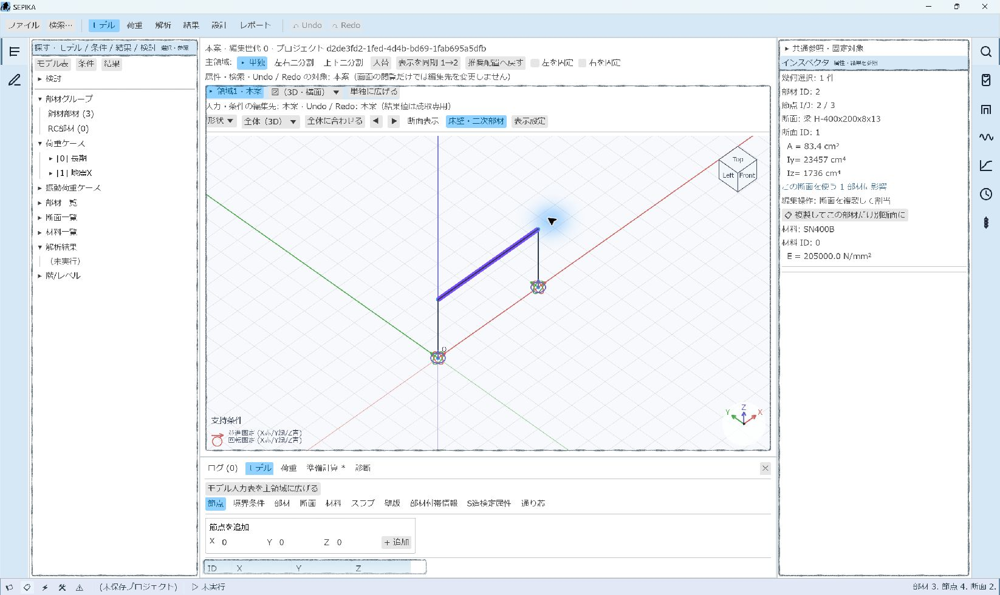
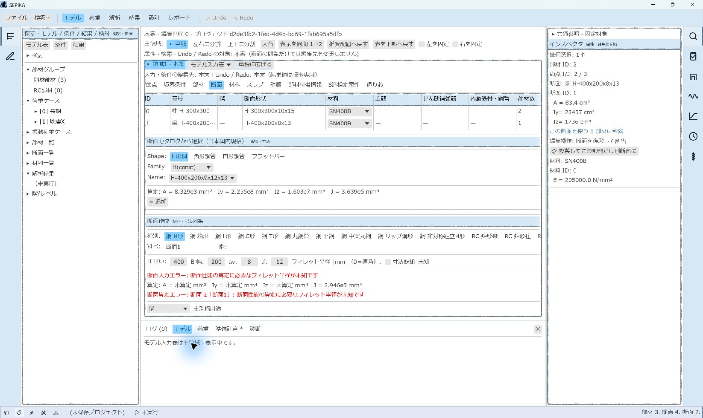
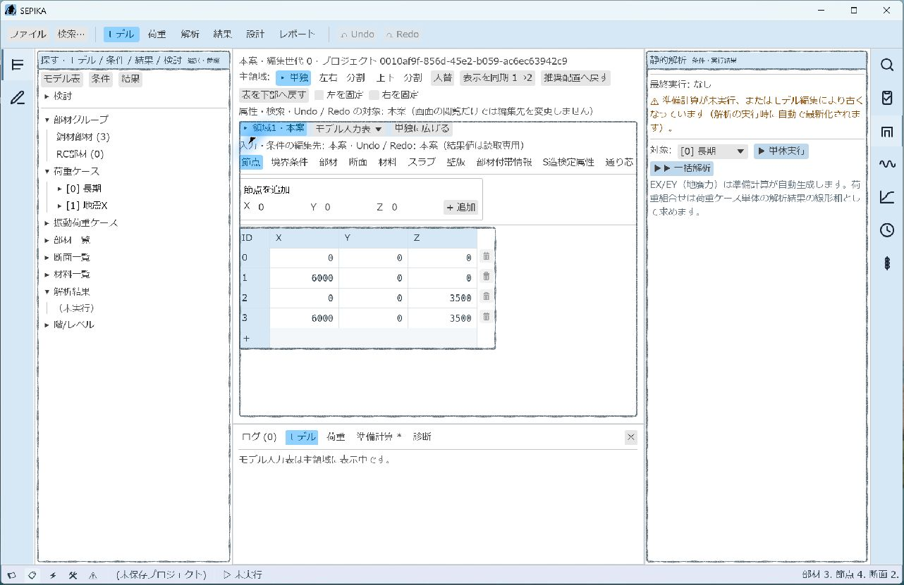
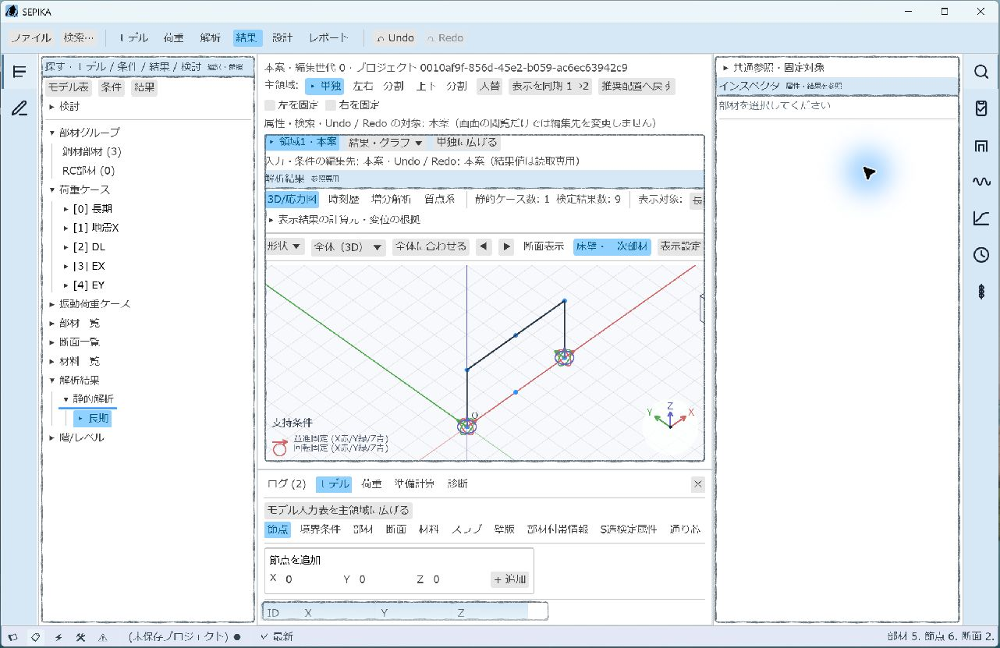
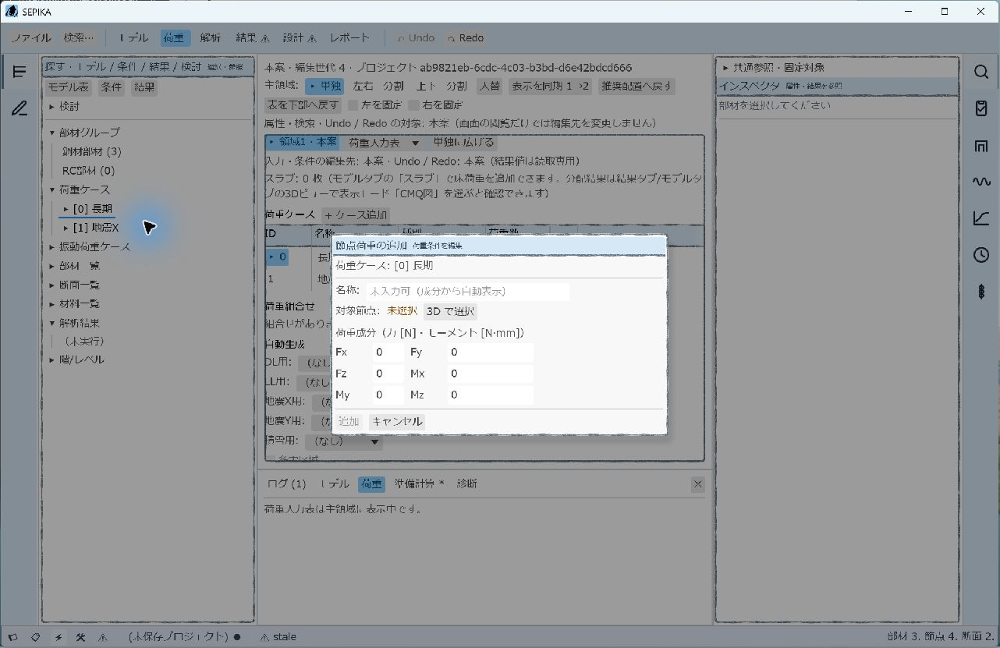
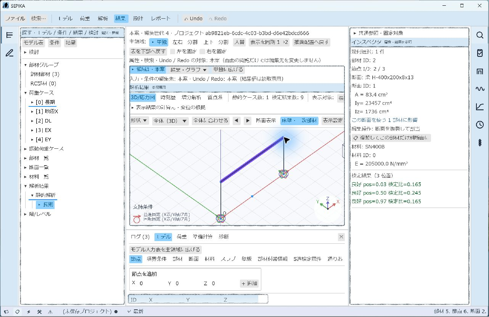
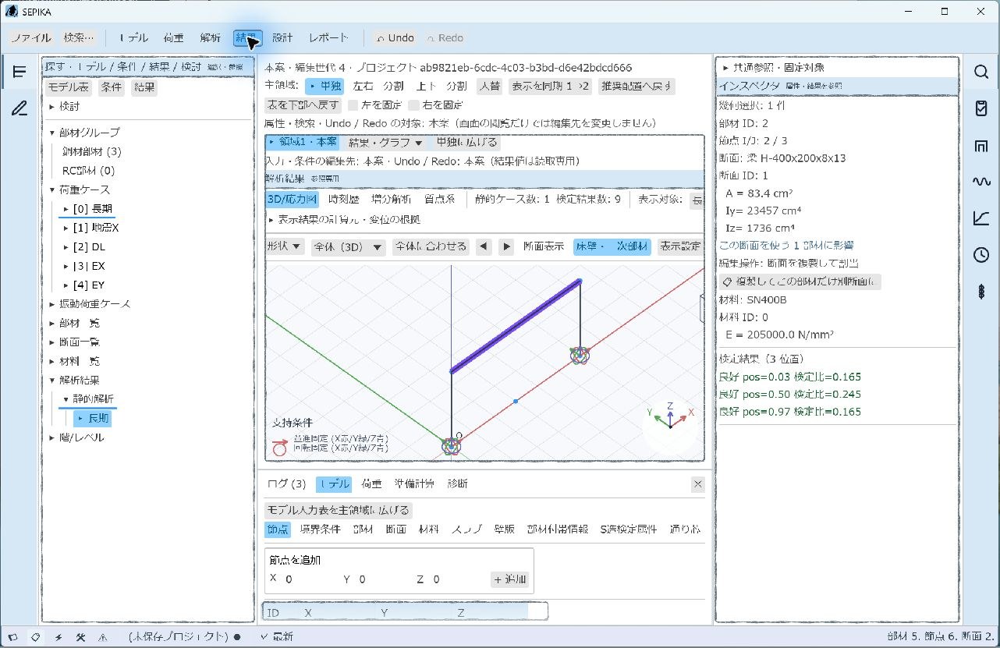

# 青系パステルGUIの確認記録（#1359）

確認日: 2026-11-06。状態は🔶（限定した自動回帰・Windows実機操作）。
[Issue #1359](https://github.com/hrntsm/SEPIKA/issues/1359)は未完了であり、
[PR #1360](https://github.com/hrntsm/SEPIKA/pull/1360)はDraftである。
必須の倍率別表示・実機の残項目・最終HEADの全CIを確認するまで完了判定へ使わない。

対象は操作画面の配色・見出し・枠・状態表示である。現在仕様は
[文字と状態表示](../../docs/model_edit/15_文字と状態表示.md)、開発時の共通ルールは
[GUIの共通表示](../README.md#guiの共通表示)を参照する。
本記録は計算式や解析結果の数値妥当性を新たに確認したものではない。

## 対象版と自動検証

実装 `ebaf61c1` と文書 `7ce7b136` の後、荷重追加・編集Modalの適用漏れを
`ce1aeba1` で修正した。次表の最終自動回帰は `ce1aeba1` のコードに対する記録である。
共通の `CARGO_TARGET_DIR=C:\Users\hiroa\Desktop\ikkan\target` を使用した。
`rustup update stable` 後のツールチェインはrustc 1.99.1、Clippy 0.1.99。

| コマンド | 結果 |
| --- | --- |
| `cargo test -p sepika-app --features gui --lib --locked` | 1212成功、0失敗、3 ignored。試験実行19.11秒。integration・doc-test全体の実行とは区別する |
| `cargo clippy -p sepika-app --features gui --all-targets --locked -- -D warnings` | 成功 |
| `cargo fmt --all -- --check` | 成功 |
| `cargo build -p sepika-app --features gui --bin sepika --locked` | 成功。起動中exeのファイルロックで一度失敗し、専用プロセス終了後の再実行で成功 |
| `cargo run -p xtask -- check-docs` | 実装・操作文書の更新時と本確認記録追加後に成功（summary 142、links 1017、impl refs 503） |
| `mdbook build docs` | 実装・操作文書の更新時と本確認記録追加後に成功 |

追加した回帰は `crates/sepika-app/src/theme.rs` の次の3件である。

| 回帰 | 保証する範囲 |
| --- | --- |
| `pencil_border_stays_stable_on_repaint_and_keeps_existing_grain_when_extended` | 同じID・位置のメッシュが一致し、辺を延長しても既存部分を保持する。1.0/1.5の描画倍率で透明外縁と線幅差を検査する |
| `group_decoration_reuses_texture_and_does_not_allocate_widget_ids` | テクスチャ再利用と入力ID不変。モデルのホバー色・鋼材面色を保持する |
| `border_texture_and_tessellation_do_not_modify_font_atlas_or_text_meshes` | 枠テクスチャとfont atlasが別IDであり、装飾追加前後でフォント画像と文字用メッシュが完全一致する |

自動回帰の1.0/1.5はeguiの描画条件であり、Windowsの100%/150%実機確認の代用ではない。
既存のGUI操作・選択・入力・モデルや結果の保持に関する回帰を含むが、実機で全入力を操作した証拠ではない。
初回テクスチャ生成をContextロック内で行った版はGUI描画のロック再入で失敗したため中止し、
生成をロック外へ移してから再検証した。失敗版の実行を上表の成功に含めない。

## 初回のWindows実機で観察した範囲

進行担当が専用のSEPIKAと組込サンプル（門型ラーメン）を操作した。
この節は初回の観察であり、後続の確定編集・最終Modal確認とは区別する。
この節と次節の2枚の画像は `7ce7b136` の版であり、`ce1aeba1` の荷重Modal修正前である。
キャプチャ寸法は起動直後1282×831 px、最大化後1646×981 px。
OSの画面解像度・表示倍率およびクライアント領域の寸法とは区別する。実効表示倍率は未取得。

| 対象 | 実測・観察 | 確認範囲の限界 |
| --- | --- | --- |
| 起動・モデル | ファイルメニューからサンプルを読み込み、部材3・節点4・断面2を表示 | 既存プロジェクトの確定編集や保存往復は実施していない |
| モデルと属性 | 梁を選択し、紫の選択線と属性欄のA=83.4 cm²、Iy=23457 cm⁴、Iz=1736 cm⁴、E=205000 N/mm²を表示 | 表示値の観察であり、新しい独立数値照合ではない |
| 断面入力表 | 表を主領域へ展開し、一覧・寸法・単位とフィレット半径未入力の赤いエラー文字を表示 | 全列・全画面の可読性確認ではない |
| 数値ドラフト | H寸法の400を425.5へ入力し、選択と入力フォーカスを確認 | 追加・更新としてモデルへ適用していない |
| 日本語IME・キー | 符号欄でAlt+grave後のa入力による未確定「あ」と候補窓を観察し、Space→Enterで確定。Tabで隣欄へ移動 | 代表1入力のみ。候補に予測履歴が含まれるためIME画像は転載しない |
| 非適用時の保持 | 上のドラフト操作中に編集世代0、Undo無効、部材・節点・断面の件数を維持 | 確定した数値編集、Undo/Redo、結果値の実機比較を確認したものではない |
| リサイズ・再描画 | 最大化リサイズと静止中の再描画で枠の揺れを観察しなかった | ホバー・スクロール中の安定性、全リサイズ条件、描画時間の定量評価は未確認 |
| 最終exe | `ce1aeba1` のexeの再起動に成功 | この段階では荷重Modalの最終外観は未確認。後続節で確認した |

キャプチャの元MIMEは `data:image/jpeg;base64` である。保存時もJPEGの内容を保持し、
PNGへの拡張子変更や再符号化による画質改善を主張しない。
文字や細線に小さな抜けが見えたため、JPEG圧縮の影響と製品の描画を切り分ける必要がある。
フォント画像・メッシュ不変の自動回帰は通過したが、キャプチャ全体の可読性が完全に確認できたとは扱わない。

## 保存した画面

いずれも最大化後1646×981 px、表示倍率未取得、`7ce7b136` の版である。
枠・見出し・内容の配置の証跡として保存し、100%/150%や最終Modalの証跡に読み替えない。

モデルと属性。梁の選択と右側の断面諸元表示を含む。

断面入力表。主領域への展開、断面作成の寸法欄と入力不足の赤い表示を含む。
H=425.5やIME操作後の画面ではない。

初回に予定した解析準備画面の画像は、保存と同じ呼出し内の操作が承認レビューで拒否され、保存されていなかった。
その画像を取得済み・確認済みとは扱わない。IME候補の画像は予測履歴を含むためリポジトリへ転載しない。

## 最終コード版での解析・結果の追加確認

後続の実機操作では `ce1aeba1` のexeを再起動した。
「サンプル(門型ラーメン)」と長期ケースの「単体実行」はアクセシビリティツリーの名称で識別し、
静的解析のアイコンは新しい画面を観察して座標で識別した。
以下の画面は1282×831 px、OSの表示倍率は引き続き未取得である。

| 対象 | 実測・観察 | 確認範囲の限界 |
| --- | --- | --- |
| 解析条件 | 静的解析の右側欄を開き、長期ケースの単体実行へ到達 | すべての解析条件の入力や方式を確認したものではない |
| 単体実行・結果 | 長期の単体実行後、静的ケース数1・検定結果数9・最新・参照専用の結果画面を表示 | 結果値の厳密な前後同値比較や独立解との照合は未実施 |
| 結果の根拠 | 計算元・変位の根拠を開く操作に成功 | 全根拠・全結果の往復は未実施。下の結果画像は根拠を開いた後の詳細画像ではない |
| 準備による変更 | 単体実行に伴う既存の準備計算で部材3→5・節点4→6となり、Undoが有効になった | 計算準備による既存処理の変化を、テーマの表示変更や未適用ドラフトによる変更と取り違えない |

静的解析の条件欄。単体実行前の準備未実行の表示と、部材3・節点4を含む。

長期単体実行後の結果表示。静的ケース1・検定結果9・部材5・節点6と最新の状態を含む。

この段階では解析条件欄・結果表示への代表導線を確認し、100%/150%、
結果値の厳密な同値比較、全操作と最終荷重Modal外観は未確認だった。
後続の代表操作と表示値比較は次節に記録する。

## 最終コード版での確定編集・荷重Modal・表示往復

DPI以外の残項目について、`ce1aeba1` のexeを新規起動して同じ組込サンプルを操作した。
この節の3枚は1282×831 pxのJPEGであり、OSの実効表示倍率は引き続き不明である。
以下は代表操作の有限確認であり、全画面・全入力・全結果を確認したものではない。

| 対象 | 実測・観察 | 確認範囲の限界 |
| --- | --- | --- |
| 数値の確定 | 節点1のX=6000 mmのセルをダブルクリックし、Ctrl+A・文字入力・Returnで6100.25 mmを確定。編集世代1・Undo有効となった | 代表の座標セル1個を確認。他の数値入力や保存往復の網羅ではない |
| Undo/Redo | Undoで6000・編集世代2・Redo有効、Redoで6100.25・世代3、再度Undoで6000・世代4へ復帰。部材3・節点4・断面2を保持 | 編集に伴う意図した履歴変化であり、表示操作で履歴を変更しない証拠と混同しない |
| 荷重追加Modal | 荷重表を主領域へ展開し、長期ケースの右クリックから節点荷重追加を開いた。淡青の見出し・白い内容面・手描き外枠・未選択の注意表示・無効な追加ボタンを視認 | 対象選択・荷重追加の確定や、編集Modal全種類の操作は未実施 |
| Modal取消 | キャンセル後も編集世代4を保持 | 荷重を追加する操作の成功や全取消経路の証明ではない |
| スクロール・静止 | 荷重表を440 pxスクロールでき、静止後に枠の揺れや明らかな遅延を観察しなかった | 連続動画、スクロール途中の全フレーム、描画時間の定量評価とは区別する |
| 再解析 | サンプルの長期を再解析し、部材5・節点6・断面2・最新・編集世代4を表示 | 準備に伴う既存の部材・節点増加であり、表示だけによる変更とは扱わない |
| 結果の表示往復 | 梁の3位置で下表の検定比を取得し、モデル表示→結果表示の往復後に同じ3表示値を確認。編集世代4・部材5・節点6・最新・Undo有効・Redo無効も保持 | 表示丸め済みの3検定比の比較であり、全内部結果のbit一致や独立数値解との比較ではない |

| 位置 | 往復前の表示検定比 | 往復後の表示検定比 |
| --- | --- | --- |
| pos=0.03 | 0.165 | 0.165 |
| pos=0.50 | 0.245 | 0.245 |
| pos=0.97 | 0.165 | 0.165 |

節点荷重追加Modal。対象未選択と追加ボタン無効の状態で、最終版の見出し・内容面・外枠を含む。

表示往復前の梁の検定比。

モデル表示から結果表示へ戻った後の同じ3検定比。

確定編集・Undo/Redo・最終Modalの代表外観と表示値保持に関する以前の未確認状態は、
上記の有限な範囲で更新する。OS100%/150%での代表画面・全代表操作・可読性・性能確認の条件は未完了であり、
Issue未完了・PR Draftを維持する。

## 実機試行の中断と未確認範囲

最初のWindows Settings起動試行は、ユーザーの明示許可以前に `sky.launch_app` の
initial app approval timeoutとなった。その後、ユーザーが設定操作と倍率別確認を明示的に許可した。
許可後の再試行でも、操作対象にできるSettingsのウィンドウを取得できなかった。

別の公式入口 `mcp__cua_repl` でも確認した。Windowsアプリの取得にはwindowIdが必須と案内され、
`listWindows` の一覧はSEPIKA・Zen・SlackのみでSettingsを含まなかったため、
この入口からもSettingsを取得できないことを最終確認した。
倍率の取得・変更は行えておらず、変更回数は0回である。元倍率を変更していないため復元すべき変更はない。

静的解析の右アイコンへの座標クリックは、自動承認レビューが
「地盤種別の条件を変える可能性があり、許可がない」として拒否したため未実行。
後に親担当が、使い捨てサンプルの条件操作・解析実行はユーザーから委任された範囲と確認した。
その後、新しい画面の座標から静的解析アイコンを識別し、上の追加確認に成功した。
サンプルの座標クリックも「項目が不確実」として一度拒否され、アクセシビリティツリーの名称で識別してから操作した。
拒否された呼出し内のクリック・画像保存を実行済みとは記録せず、後続の成功と区別する。

本Issueの完了には、少なくとも次の実機確認と最終検証を完了し、証拠を追加する必要がある。

- Windowsの100%・150%を取得して、モデル＋属性・断面入力表・解析条件・結果を寸法とともに記録する。
- 倍率別の全代表操作で、ホバー・スクロール・再描画・リサイズ中の枠と文字の可読性、明らかな遅延がないことを確認する。今回の有限な静止観察を、連続表示や定量的な性能評価へ拡張しない。
- 確認済みの代表セル・Modal・3検定比を超える未確認範囲を保持し、表示丸め値の比較を全内部結果のbit一致とは扱わない。
- 最終HEADの全CIの成功を確認する。`6b768d08` ではfeature構成などの一部ジョブが成功し、workspace/Windowsのジョブは未完了との報告を受けた。本記録更新後の最終CI成功とは区別する。

残項目は[未検証一覧](未検証一覧.md#青系パステルguiの実機確認1359)と
[Issue #1359](https://github.com/hrntsm/SEPIKA/issues/1359)で追跡する。

## 独立レビューの確認範囲

fresh reviewer2から、`main...ce1aeba1` のコード差分に修正必須の指摘なしと報告を受けた。
同レビューではthemeの11件・gridの41件の試験、fmt・diff check・check-docs・mdbookの成功を確認した。
これはコード差分に対する独立確認であり、Windowsの倍率別表示や未実施の実機操作、
本記録の文言訂正を含む最終HEADの全CI成功を確認したものではない。

## 本記録追加後の文書検証

2026-11-06に `cargo run -p xtask -- check-docs`（summary 142、links 1017、impl refs 503）、
`mdbook build docs`、`git diff --check` が成功した。
開発者向けの記録・索引・未検証一覧間の参照と、7枚のJPEGの保存先も確認した。
この文書検証は、上記の未実施実機条件や最終CIを確認したことを意味しない。
