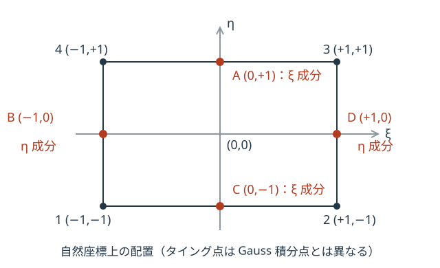

# MITC4 シェル要素

せん断ロッキングを回避する混合補間法 MITC4（Mixed Interpolation of Tensorial Components）を用い、膜・曲げ・せん断・ドリリング安定化を含む板要素の剛性を算定します。

## 自由度・材料・適用条件

4節点の各節点に局所面内の並進2成分、法線方向並進1成分、回転3成分を持つ24自由度モデルです。局所第1軸は第1節点から第2節点、第3軸は二本の対角線の外積による面法線、第2軸は右手系を満たす面内軸です。並進は mm、回転は rad、力は N、モーメントは N·mm です。面内は等方性の平面応力、面外は曲げと横せん断で表します。ドリリング回転は法線まわりの回転で、安定化剛性は板の実際の面内曲げ耐力を表しません。

板厚・材料と、面を定められる4節点の幾何が必要です。G は E とポアソン比から G=E/{2(1+ν)} で求めます。材料・板厚・幾何が不成立な場合、得られた値を有効な板剛性の結果として解釈できません。解析前チェックの指摘を解消し、板厚・材料・節点形状を確認してください。

## 剛床との組合せ

4節点のすべてがそれぞれ剛床に所属すると、シェル自身の膜剛性を算入しません。同一の剛床への所属に限る判定ではなく、一部の節点だけが剛床に属する場合は膜剛性を算入します。曲げ・横せん断による面外抵抗は残します。

膜剛性を算入しない場合、局所面内並進2成分と法線まわり回転の結合を除き、その対角に数値的な剛性を残すため、面内成分は厳密なゼロにはなりません。この数値成分を床版の物理的な面内剛性・耐力と解釈しないでください。剛床拘束は別途節点変位の適合を与えます。水平な板ではこれらは全体 Ux・Uy・Rz に対応し、傾いた板では局所面内成分と全体の水平成分を区別する必要があります。

## 変位・ひずみ・断面力の規約

以下では線形弾性・微小変形、要素内で一定の板厚・材料を扱います。局所第1・第2・第3軸をそれぞれ \\(x,y,z\\) とし、板中央面を \\(z=0\\) とします。節点を周に沿って1〜4とし、局所節点変位と要素変位を次の順で並べます。回転は各局所軸まわりの右ねじ方向を正とします。

\\[
\\boldsymbol q_i=(u_i,v_i,w_i,\\theta_{xi},\\theta_{yi},\\theta_{zi})^T,
\\qquad
\\boldsymbol q=(\\boldsymbol q_1^T,\\boldsymbol q_2^T,\\boldsymbol q_3^T,\\boldsymbol q_4^T)^T
\\]

| 記号 | 意味 | 単位・条件 |
| --- | --- | --- |
| \\(u,v,w\\) | 中央面の局所 \\(x,y,z\\) 方向変位 | mm |
| \\(\\theta_x,\\theta_y,\\theta_z\\) | 局所各軸まわりの回転 | rad。\\(\\theta_z\\) はドリリング回転 |
| \\(E,G\\) | ヤング係数、せん断弾性係数 | N/mm²、\\(G=E/[2(1+\\nu)]\\) |
| \\(\\nu,t\\) | ポアソン比、板厚 | 順に無次元、mm |
| \\(\\boldsymbol\\varepsilon_m\\) | 膜ひずみ \\((\\varepsilon_x,\\varepsilon_y,\\gamma_{xy})^T\\) | 無次元 |
| \\(\\boldsymbol\\kappa\\) | 曲率 \\((\\kappa_x,\\kappa_y,\\kappa_{xy})^T\\) | 1/mm |
| \\(\\boldsymbol\\gamma_s\\) | 横せん断ひずみ \\((\\gamma_{xz},\\gamma_{yz})^T\\) | 無次元 |
| \\(\\boldsymbol n\\) | 膜力 \\((n_x,n_y,n_{xy})^T\\) | N/mm |
| \\(\\boldsymbol m\\) | 曲げ・ねじりモーメント \\((m_x,m_y,m_{xy})^T\\) | N·mm/mm |
| \\(\\boldsymbol q_s\\) | 横せん断力 \\((q_x,q_y)^T\\) | N/mm |

せん断ひずみには工学せん断規約 \\(\\gamma_{xy}=2\\varepsilon_{xy}\\)、\\(\\gamma_{xz}=2\\varepsilon_{xz}\\)、\\(\\gamma_{yz}=2\\varepsilon_{yz}\\) を用います。ねじり曲率 \\(\\kappa_{xy}\\) も工学せん断ひずみの板厚方向変化率です。中央面から距離 \\(z\\) の面内ひずみは \\(\\boldsymbol\\varepsilon_m+z\\boldsymbol\\kappa\\) となり、各モーメントの符号はこの曲率に対応します。

自然座標 \\((\\xi,\\eta)\\) の各節点位置を \\((-1,-1),(+1,-1),(+1,+1),(-1,+1)\\) とし、双一次形状関数で変位と回転を補間します。

\\[
N_i=\\frac14(1+\\xi_i\\xi)(1+\\eta_i\\eta),\\qquad
(u,v,w,\\theta_x,\\theta_y)=\\sum_{i=1}^4 N_i(u_i,v_i,w_i,\\theta_{xi},\\theta_{yi})
\\]

膜ひずみと曲率はその空間微分から求めます。以下の \\(B_m,B_b\\) はそれぞれ3×24のひずみ–節点変位関係行列です。

\\[
\\boldsymbol\\varepsilon_m=
\\begin{bmatrix}
\\partial u/\\partial x \\\\
\\partial v/\\partial y \\\\
\\partial u/\\partial y+\\partial v/\\partial x
\\end{bmatrix}
=B_m\\boldsymbol q,
\\qquad
\\boldsymbol\\kappa=
\\begin{bmatrix}
\\partial\\theta_y/\\partial x \\\\
-\\partial\\theta_x/\\partial y \\\\
\\partial\\theta_y/\\partial y-\\partial\\theta_x/\\partial x
\\end{bmatrix}
=B_b\\boldsymbol q
\\]

## 構成則

膜は等方性の平面応力状態です。面内応力度と工学せん断ひずみを結ぶ平面応力の弾性行列を、板厚方向に積分して膜力へ変換します。曲げではさらに \\(z^2\\) を積分するため、\\(\\int_{-t/2}^{t/2}z^2\\,dz=t^3/12\\) が係数になります。中央面について対称な一様板なので膜と曲げの連成項はありません。

\\[
D_m=\\frac{Et}{1-\\nu^2}
\\begin{bmatrix}
1 & \\nu & 0 \\\\
\\nu & 1 & 0 \\\\
0 & 0 & (1-\\nu)/2
\\end{bmatrix},
\\qquad \\boldsymbol n=D_m\\boldsymbol\\varepsilon_m
\\]

\\[
D_b=\\frac{Et^3}{12(1-\\nu^2)}
\\begin{bmatrix}
1 & \\nu & 0 \\\\
\\nu & 1 & 0 \\\\
0 & 0 & (1-\\nu)/2
\\end{bmatrix},
\\qquad \\boldsymbol m=D_b\\boldsymbol\\kappa
\\]

\\[
D_s=\\frac56 Gt
\\begin{bmatrix}
1 & 0 \\\\
0 & 1
\\end{bmatrix},
\\qquad \\boldsymbol q_s=D_s\\boldsymbol\\gamma_s
\\]

\\(D_m,D_s\\) の各係数の単位は N/mm、\\(D_b\\) は N·mm です。膜・曲げの第3対角係数は工学せん断規約に対応し、それぞれ \\(Gt\\)、\\(Gt^3/12\\) となります。横せん断にはせん断補正係数 \\(5/6\\) を用います。これらは厚さ積分済みの構成則であり、要素面積の積分時に板厚を重ねて掛けません。

## MITC4 の横せん断補間

変位と回転から直接求める横せん断ひずみを、まず次のように定義します。

\\[
\\boldsymbol\\gamma_s^{\\mathrm{std}}=
\\begin{bmatrix}
\\partial w/\\partial x+\\theta_y \\\\
\\partial w/\\partial y-\\theta_x
\\end{bmatrix}
\\]

この値を要素全面でそのまま使うと、薄板の曲げでも不要な横せん断抵抗が残るせん断ロッキングが生じます。MITC4 では4辺の中央のタイング点で変位・回転から得た横せん断を採り、その自然座標方向の共変成分を補間します。タイング点は横せん断場を定める点で、剛性を積分する Gauss 点とは異なります。

図は自然座標上の配置です。物理座標では、各節点の座標 \\((x_i,y_i)\\) と同じ形状関数により \\((x,y)=\\sum_iN_i(x_i,y_i)\\) と写像します。ヤコビアンと、ここで用いる共変成分 \\(\\widehat\\gamma_\\xi,\\widehat\\gamma_\\eta\\) を次で定めます。

\\[
J=
\\begin{bmatrix}
\\partial x/\\partial\\xi & \\partial y/\\partial\\xi \\\\
\\partial x/\\partial\\eta & \\partial y/\\partial\\eta
\\end{bmatrix},
\\qquad
\\begin{bmatrix}\\widehat\\gamma_\\xi\\\\\\widehat\\gamma_\\eta\\end{bmatrix}
=J\\boldsymbol\\gamma_s^{\\mathrm{std}}
\\]

\\(J\\) の成分と \\(\\widehat\\gamma\\) の単位は mm です。この \\(\\widehat\\gamma\\) は局所直交座標の工学せん断を自然座標の面内接線へ写した量で、板厚方向の座標を無次元化した3次元ひずみテンソル成分そのものとは区別します。A・Cで \\(\\xi\\) 方向成分、B・Dで \\(\\eta\\) 方向成分を採り、次の補間を行います。

\\[
\\widehat\\gamma_\\xi^{\\mathrm{MITC}}(\\xi,\\eta)
=\\frac{1+\\eta}{2}\\widehat\\gamma_\\xi^A
+\\frac{1-\\eta}{2}\\widehat\\gamma_\\xi^C
\\]

\\[
\\widehat\\gamma_\\eta^{\\mathrm{MITC}}(\\xi,\\eta)
=\\frac{1-\\xi}{2}\\widehat\\gamma_\\eta^B
+\\frac{1+\\xi}{2}\\widehat\\gamma_\\eta^D
\\]

評価位置の逆ヤコビアンで局所直交成分に戻したものを、構成則へ渡す横せん断ひずみとします。この関係を表す \\(B_s\\) は2×24行列です。

\\[
\\boldsymbol\\gamma_s=
J^{-1}
\\begin{bmatrix}
\\widehat\\gamma_\\xi^{\\mathrm{MITC}} \\\\
\\widehat\\gamma_\\eta^{\\mathrm{MITC}}
\\end{bmatrix}
=B_s\\boldsymbol q
\\]

## 要素剛性と数値安定化

膜・曲げ・横せん断によるひずみエネルギーを足し合わせると、局所要素剛性の物理的な寄与は次の面積積分になります。\\(A_e\\) は要素中央面の領域、\\(dA\\) は mm² です。

\\[
K_{\\mathrm{phys}}=\\int_{A_e}
\\left(B_m^TD_mB_m+B_b^TD_bB_b+B_s^TD_sB_s\\right)\\,dA
\\]

\\(\\mathcal H=B_m^TD_mB_m+B_b^TD_bB_b+B_s^TD_sB_s\\) と置き、自然座標への写像 \\(dA=\\det J\\,d\\xi\\,d\\eta\\) を使って2×2 Gauss 積分します。4点は \\((\\xi,\\eta)=(\\pm1/\\sqrt3,\\pm1/\\sqrt3)\\) の全組合せで、各点の重み \\(w_g\\) は1です。

\\[
K_{\\mathrm{phys}}\\simeq
\\sum_{g=1}^4 w_g\\mathcal H(\\xi_g,\\eta_g)\\det J(\\xi_g,\\eta_g)
\\]

これらの \\(B\\) 行列には \\(\\theta_z\\) の抵抗がないため、ドリリング回転の数値安定化を別に加えます。\\(A\\) を要素面積、\\(\\alpha_d\\) をドリリング安定化係数（既定 \\(10^{-3}\\)、無次元）とすると、法線まわり回転4成分に加える部分行列は次です。\\(I_4\\) は4×4単位行列、\\(\\boldsymbol1\\) は4成分すべてが1の列ベクトルです。

\\[
s_d=\\alpha_dGtA,\\qquad
K_{d,\\theta_z}=s_d\\left(I_4-\\frac14\\boldsymbol1\\boldsymbol1^T\\right),
\\qquad K_{\\mathrm{local}}=K_{\\mathrm{phys}}+K_d
\\]

\\(s_d\\) の単位は N·mm です。\\(K_d\\) は上記部分以外をゼロとする24×24行列で、節点間の法線まわり回転差に抵抗し、4節点共通の回転には抵抗しません。物理的な膜・曲げ・横せん断の構成則とは別の数値寄与であり、実際の板の面内曲げ耐力には使えません。\\(K_{\\mathrm{local}}\\boldsymbol q\\) は節点の力 [N] とモーメント [N·mm] を自由度順に与えるため、剛性行列全体に単一の単位を付けることはできません。

以上は膜剛性を算入する場合の式です。[剛床との組合せ](#剛床との組合せ)に該当する場合は膜の積分寄与を除き、同節に示す面内成分の処置を適用します。

## 計算根拠と確認範囲

MITC4 の横せん断補間の一次根拠は、K.-J. Bathe・E. N. Dvorkin, “A four-node plate bending element based on Mindlin/Reissner plate theory and a mixed interpolation”, *International Journal for Numerical Methods in Engineering*, Vol.21, pp.367–383, 1985（[著者のMIT公開本文](https://web.mit.edu/kjb/www/Publications_Prior_to_1998/A_Four-Node_Plate_Bending_Element_Based_on_Mindlin_Reissner_Plate_Theory_and_a_Mixed_Interpolation.pdf)、[DOI](https://doi.org/10.1002/nme.1620210213)）です。

曲率・横せん断の符号、曲げ・横せん断の構成則と補正係数は pp.368–369 の式(1)〜(5)、タイング点と補間は pp.370–371 の図2・式(6)、共変成分の補間と直交成分への変換は pp.381–382 の付録I・式(15)・(20)を根拠とします。本頁では原典の \\(r,s,h,\\beta_x,\\beta_y\\) を \\(\\xi,\\eta,t,\\theta_y,\\theta_x\\) に対応させています。図の節点番号は本頁の自然座標配置を用い、原典の図2の番号をそのまま転記していません。

膜の構成則は前述の平面応力則の厚さ積分です。24自由度への膜・ドリリング回転の追加と数値安定化係数は本頁で示した採用仕様であり、上記原典の板曲げ定式化と同一とするものではありません。原典の非線形シェル全体や、反り・凹形状への適用性まで確認済みとする説明ではありません。

## 質量と結果

平面凸四角形の面積 A [mm²] は、節点を周に沿って1〜4としたとき、共通対角線1–3で分けた三角形1–2–3と1–3–4の面積の和です。各三角形の面積は2辺の外積の大きさの1/2で求めます。節点の開始位置・周回方向、板の剛体移動によらず同じ面積を用い、集中質量とドリリング安定化の両方へ適用します。反りや凹形状に対する面積近似・適用範囲の拡張を意味しません。

膜力・曲げモーメント・横せん断力は、上記の2×2 Gauss 点で節点変位からひずみ・曲率を求め、それぞれの構成則を適用した単位幅あたりの断面力です。局所座標の成分であり、節点力や板厚内の一点の応力度とは区別します。

集中質量は総質量 ρtA を4節点の各並進へ均等配分します。整合質量は双一次形状関数の積に ρt を掛けて面積積分し、並進成分へ配分します。どちらも回転慣性の成分を加えません。密度は t/mm³、総質量は t です。膜力は単位長さあたりの力 [N/mm]、板の曲げ・ねじりモーメントは単位長さあたりのモーメント [N·mm/mm] であり、線材の断面力とは単位が異なります。

平面上の座標 (0,0), (4000,0), (3000,3000), (0,2000) mm の面積は9,000,000 mm²です。板厚100 mm・密度2.4×10⁻⁹ t/mm³では総質量2.16 t、集中質量の各節点各並進は0.54 tです。これは3方向の合計を総質量とする意味ではありません。

**実装参照**：`sepika_element::shell::ShellElement::{local_stiffness, add_drilling}`（`crates/sepika-element/src/shell/stiffness.rs`）が剛性と安定化を算定します。ひずみ–節点変位関係は `shell::bmatrix`（`crates/sepika-element/src/shell/bmatrix.rs`）、構成則は `shell::constitutive`（`crates/sepika-element/src/shell/constitutive.rs`）、断面力は `ShellElement::recover_resultants`（`crates/sepika-element/src/shell/recovery.rs`）、形状関数・積分点は `shell::shape`（`crates/sepika-element/src/shell/shape.rs`）を参照してください。面積は `shell::geom::element_area`（`crates/sepika-element/src/shell/geom.rs`）、質量は `shell::element_behavior`（`crates/sepika-element/src/shell/element_behavior.rs`）で扱います。

