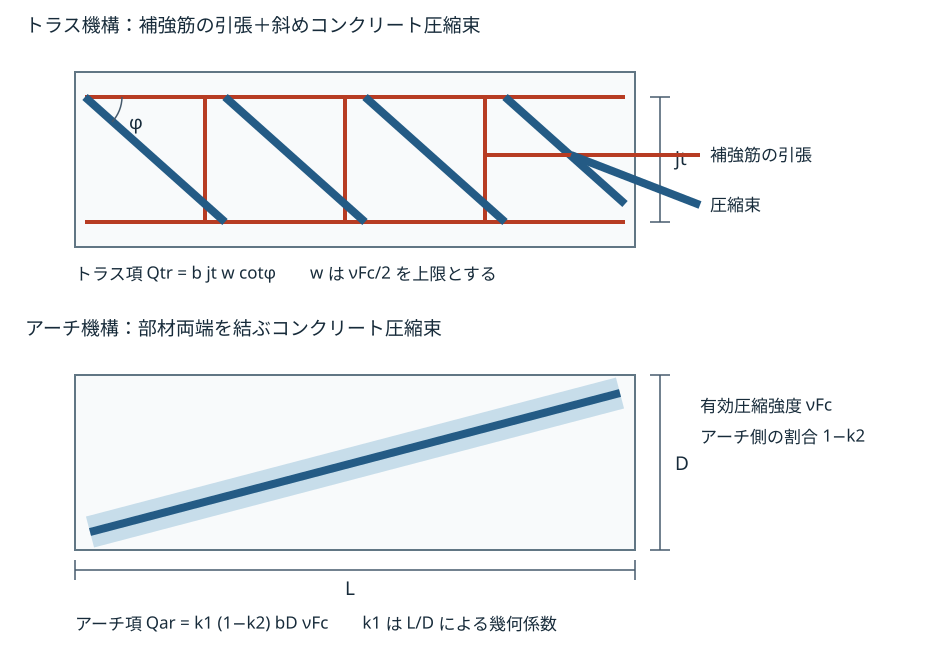

# RC梁・柱の終局せん断耐力（塑性理論式）

RC梁・柱の終局検定で既定の塑性理論式を選んだとき、トラス機構とアーチ機構から終局せん断耐力を求めます。

[共通の入力・記号・単位](02_RC_終局せん断.md#入力記号単位)に従い、断面・配筋・材料を確認します。軽量コンクリートでは算定した耐力を0.9倍します。[確認済みの範囲と適用限界](02_RC_終局せん断.md#根拠と適用限界)も参照してください。

## 塑性理論式 Qsu（トラス＋アーチ機構）

せん断力を、補強筋の引張と斜めコンクリート圧縮束で伝えるトラス機構と、部材両端を結ぶコンクリート圧縮束によるアーチ機構に分けて評価します。
下図は各項の役割を示す模式図です。両機構は同じ部材内で抵抗し、コンクリートの有効圧縮強度を両方へ無制限に重複計上しません。

通常コンクリートの算定値を、説明用に \\(Q_{tr}\\) と \\(Q_{ar}\\) に分けると次式です。両項ともNです。

\\[
Q_{su}=Q_{tr}+Q_{ar},\qquad
Q_{tr}=bj_t w\cot\varphi,\qquad
Q_{ar}=k_1(1-k_2)bD\nu F_c
\\]

\\[
w=\min\\{\max(p_w,0)\max(\sigma_{wy},0),\nu F_c/2\\}
\\]

\\[
\nu_0=\max(0.7-F_c/200,0),\qquad
\nu=\begin{cases}
\nu_0 & R_p\le0\\\\
(1-15R_p)\nu_0 & 0<R_p\le0.05\\\\
0.25\nu_0 & R_p>0.05
\end{cases}
\\]

\\[
\cot\varphi=\begin{cases}
2 & R_p\le0\\\\
2-50R_p & 0<R_p\le0.02\\\\
1 & R_p>0.02
\end{cases},\qquad
k_1=\frac{\sqrt{(L/D)^2+1}-L/D}{2},\qquad
k_2=\min\left(\frac{2\max(p_w,0)\max(\sigma_{wy},0)}{\nu F_c},1\right)
\\]

各係数は次の役割を持ちます。以下は採用式の項の読み方であり、係数の導出や原典の全適用条件を確認したことを意味しません。

| 量 | 抵抗項とのつながり |
| --- | --- |
| \\(\nu F_c\\) | コンクリートの有効圧縮強度。Fcをそのまま使わず、ν0とRpによる低減を反映し、トラス項のwの上限とアーチ項の双方に用いる |
| \\(w\\) | 補強筋比と降伏強度の積を有効圧縮強度の半分で制限した応力度（N/mm²）。補強筋量だけでトラス項が無制限に増えないようにする |
| \\(\cot\varphi\\) | 材軸とトラス圧縮束のなす角φの係数。応力中心距離jtとともに、補強筋の抵抗からトラス項のせん断力を求める。Rpの増加で2から1へ低減する |
| \\(k_1\\) | 内法長さと全せいの比L/Dによるアーチ機構の幾何係数。L/Dが大きいほど小さい |
| \\(k_2\\) | 補強筋応力積に応じたトラス機構側の寄与率。アーチ項には残りの割合1−k2を用い、k2=1ならアーチ項は0 |

νFc>0の範囲では、補強筋応力積が0ならトラス項は0、k2=0となり、アーチ項だけが残ります。
補強筋応力積がνFc/2に達すると、wは上限、k2=1となり、トラス項だけが残ります。
中間では両項を加えますが、補強筋を増やすとアーチ側の割合は減るため、トラス項だけの増分を総耐力の増分とはみなしません。
νFcが0以下ならk2=1としてアーチ項を0にします。
トラス項の補強筋応力積はνFc/2を上限とし、アーチ項も負にしません。Lが負の場合はk1=0です。

関連項目は[RC部材の終局検定に用いる耐力](02_RC_終局せん断.md)、[RC梁・柱の付着割裂耐力](02_02_RC梁_柱の付着割裂耐力.md)、[部材の終局検定](07_終局検定の統括.md)を参照してください。
