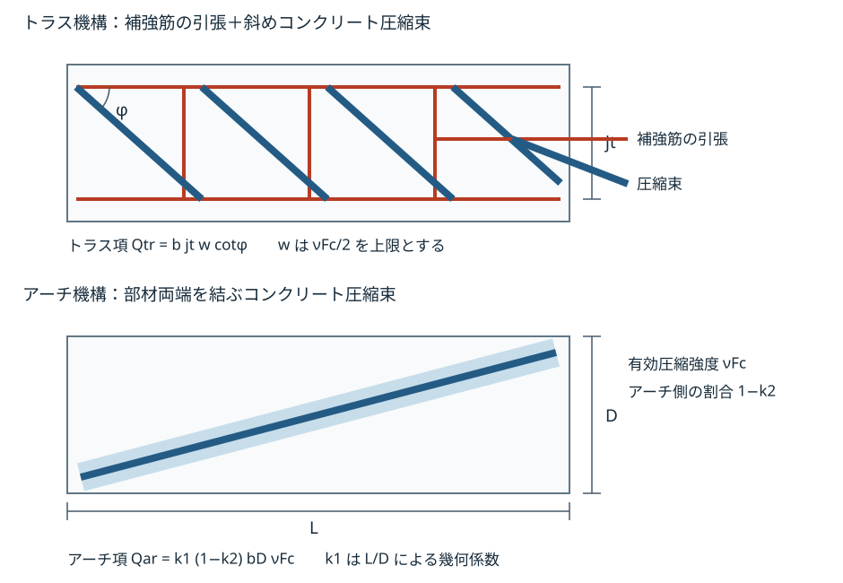

# RC 終局せん断（塑性理論式・靭性指針式）

RC梁・柱の終局検定では、塑性理論式（既定）または靭性指針式を選びます。
本頁は耐力の算定方法です。長期せん断力の控除、確定総応答との比較、余裕度の採用は[終局検定の統括](07_終局検定の統括.md)を参照してください。
部材ランク・増分解析のせん断降伏表示に用いる[荒川mean式系](01_RC_部材_略算終局耐力.md#終局せん断耐力荒川-mean-式系)とは別の算定です。

## 入力・記号・単位

断面寸法・実配筋・かぶり・補強筋径と脚数・間隔、主筋材料・せん断補強筋材料、コンクリート強度を用います。
主筋強度は割り当てた主筋材料から採用します。せん断補強筋強度はその材料から求め、未割当の場合の代表値は295 N/mm²です。割当済み材料の未対応グレードや強度欠落は未割当と区別してエラーとします。
塑性回転角Rpの共通指定は既定0 radで、増分の確定総応答による検定では当該部材の採用応答値（負値は0）を優先します。軽量コンクリートの指定時はQsu・Qbu・Vu・Vbuの算定値をそれぞれ0.9倍します。

| 記号 | 意味 | 単位 |
| --- | --- | --- |
| \\(Q_{su},Q_{bu}\\) | 塑性理論式の終局せん断耐力・付着割裂耐力 | N |
| \\(V_u,V_{bu}\\) | 靭性指針式のせん断信頼強度・付着破壊考慮せん断信頼強度 | N |
| \\(b,D,d\\) | 検討方向の断面幅・全せい・圧縮縁から引張筋重心までの有効せい | mm |
| \\(j_t,j_e\\) | トラス機構の応力中心距離・有効せい。本検定ではともに7d/8 | mm |
| \\(L\\) | 内法長さ | mm |
| \\(A_w,s,n_w\\) | 検討方向の補強筋1組の断面積・間隔・脚数。Awは脚数×1本の面積 | mm², mm, 本 |
| \\(p_w,p_{we}\\) | 補強筋比Aw/(bs)・有効補強筋比Aw/(be s) | 小数（無次元） |
| \\(F_c,\sigma_{wy},\sigma_y\\) | コンクリート設計基準強度・補強筋降伏強度・主筋降伏強度 | N/mm² |
| \\(R_p\\) | ヒンジ領域の塑性回転角 | rad |
| \\(\nu_0,\nu,k_1,k_2,k_3,\cot\varphi\\) | 有効係数・機構の係数（以下で定義） | 無次元 |
| \\(\tau_{bu},\sum\varphi\\) | 主筋の付着信頼強度・引張主筋の周長和 | N/mm², mm |
| \\(a_g,N_{uc},N_{ut}\\) | 全主筋面積・柱の圧縮／引張軸終局耐力 | mm², N, N |

Rpは回転角であり、降伏変形に対する変形の比である無次元の塑性率ではありません。例えばRp=0.02は0.02 radを意味し、塑性率2を意味しません。後述する靭性指針式のμも機構係数であり、部材塑性率とは別です。

矩形断面は検討方向の幅・せいを使います。円形柱は面積を等しくする正方形の辺長 \\(b=D=\sqrt{\pi D_c^2/4}\\) に置換します（Dcは実直径）。有効せいはこの辺長からかぶり・帯筋径・主筋径/2を引き、引張主筋面積は全主筋の1/4とします。帯筋は検討方向あたり2本の閉鎖フープとしてAwを求め、脚数の個別指定には未対応です。円形の置換による全適用域の安全性は確認済みではありません。
補強筋間隔が0以下ならpw・pweを0とし、せん断補強筋の耐力寄与を見込みません。自動部材ランク判定も同じpw=0を用います。

## 塑性理論式 Qsu（トラス＋アーチ機構）

せん断力を、補強筋の引張と斜めコンクリート圧縮束で伝えるトラス機構と、部材両端を結ぶコンクリート圧縮束によるアーチ機構に分けて評価します。
下図は各項の役割を示す模式図です。両機構は同じ部材内で抵抗し、コンクリートの有効圧縮強度を両方へ無制限に重複計上しません。

通常コンクリートの算定値を、説明用に \\(Q_{tr}\\) と \\(Q_{ar}\\) に分けると次式です。両項ともNです。

\\[
Q_{su}=Q_{tr}+Q_{ar},\qquad
Q_{tr}=bj_t w\cot\varphi,\qquad
Q_{ar}=k_1(1-k_2)bD\nu F_c
\\]

\\[
w=\min\\{\max(p_w,0)\max(\sigma_{wy},0),\nu F_c/2\\}
\\]

\\[
\nu_0=\max(0.7-F_c/200,0),\qquad
\nu=\begin{cases}
\nu_0 & R_p\le0\\\\
(1-15R_p)\nu_0 & 0<R_p\le0.05\\\\
0.25\nu_0 & R_p>0.05
\end{cases}
\\]

\\[
\cot\varphi=\begin{cases}
2 & R_p\le0\\\\
2-50R_p & 0<R_p\le0.02\\\\
1 & R_p>0.02
\end{cases},\qquad
k_1=\frac{\sqrt{(L/D)^2+1}-L/D}{2},\qquad
k_2=\min\left(\frac{2\max(p_w,0)\max(\sigma_{wy},0)}{\nu F_c},1\right)
\\]

各係数は次の役割を持ちます。以下は採用式の項の読み方であり、係数の導出や原典の全適用条件を確認したことを意味しません。

| 量 | 抵抗項とのつながり |
| --- | --- |
| \\(\nu F_c\\) | コンクリートの有効圧縮強度。Fcをそのまま使わず、ν0とRpによる低減を反映し、トラス項のwの上限とアーチ項の双方に用いる |
| \\(w\\) | 補強筋比と降伏強度の積を有効圧縮強度の半分で制限した応力度（N/mm²）。補強筋量だけでトラス項が無制限に増えないようにする |
| \\(\cot\varphi\\) | 材軸とトラス圧縮束のなす角φの係数。応力中心距離jtとともに、補強筋の抵抗からトラス項のせん断力を求める。Rpの増加で2から1へ低減する |
| \\(k_1\\) | 内法長さと全せいの比L/Dによるアーチ機構の幾何係数。L/Dが大きいほど小さい |
| \\(k_2\\) | 補強筋応力積に応じたトラス機構側の寄与率。アーチ項には残りの割合1−k2を用い、k2=1ならアーチ項は0 |

νFc>0の範囲では、補強筋応力積が0ならトラス項は0、k2=0となり、アーチ項だけが残ります。
補強筋応力積がνFc/2に達すると、wは上限、k2=1となり、トラス項だけが残ります。
中間では両項を加えますが、補強筋を増やすとアーチ側の割合は減るため、トラス項だけの増分を総耐力の増分とはみなしません。
νFcが0以下ならk2=1としてアーチ項を0にします。
トラス項の補強筋応力積はνFc/2を上限とし、アーチ項も負にしません。Lが負の場合はk1=0です。

## 付着割裂耐力 Qbu

\\[
Q_{bu}=j_t\tau_{bu}\sum\varphi+k_1(1-k_3)bD\nu F_c,\qquad
k_3=\min\left(\frac{2\tau_{bu}\sum\varphi}{b\nu F_c},1\right)
\\]

第1項は、主筋の周長和に沿って伝達できる単位長さ当たり付着力 \\(\tau_{bu}\sum\varphi\\)（N/mm）にjtを乗じたせん断力です。
第2項はアーチ項で、k3が付着力に応じてその寄与を制限します。k3=1ならアーチ項は0です。
この式でも両項を加えますが、付着による伝達能力と独立にアーチ全量を加える扱いではありません。
ν・k1は塑性理論式と同じ定義です。τbu・Σφの負値は0とし、bνFcが0以下ならk3=1とします。

\\[
\tau_{bu}=\alpha_t\\{(0.085b_1+0.10)\sqrt{F_c}+k_{st}\\},\qquad
\alpha_t=\begin{cases}\max(0.75-F_c/400,0)&\text{梁上端筋}\\\\1&\text{その他}\end{cases}
\\]

\\[
b_1=\max\\{\min(b_{vi},b_{ci},b_{si}),0\\},\quad
b_{vi}=\sqrt3(2C_{min}/d_{b1}+1),\quad
b_{ci}=\sqrt2\\{(C_s+C_b)/d_{b1}-1\\},\quad
b_{si}=b/(N_1d_{b1})-1
\\]

\\[
C_{min}=\min(C_s,C_b),\qquad k_{st}=140A_w/(d_{b1}s)
\\]

Cs・Cbは主筋の側面・底面（上面）かぶり、db1は主筋径でいずれもmm、N1は引張筋本数です。b1・αtは無次元、kstはN/mm²相当として上式へ入力します。補強筋間隔が0以下ならkst=0です。

本検定はCs=Cb=入力かぶりとし、Σφ=N1πdb1とします。N1と引張主筋面積の採用範囲は断面で異なります。

- 梁は引張側の全段の本数・面積を集約します。
- 矩形柱は検討辺の最外段1列だけの本数・面積を用い、内側の段を加算しません。有効せいも、断面せいからその最外段の重心距離（かぶり+帯筋径+主筋径/2）を引いた値です。
- 円形柱のN1は換算引張面積（全主筋面積の1/4）を1本の面積で除して四捨五入します。

各段のかぶり・付着強度を独立評価する計算ではありません。
資料に挙げられるkstの二分岐のうち、横補強筋による拘束効果の代表式140Aw/(db1 s)を全域に用いています。bci≥bsi側の \\((54+45N_w/N_1)(b_{si}+1)p_w\\) への切替は行いません（Nwは中子筋本数）。この分岐省略、梁の全段集約や柱の上記換算が常に安全側になる保証はなく、個別部材への設計適用には別途確認が必要です。

## 靭性指針式せん断信頼強度 Vu / Vbu

塑性理論式と異なるν・機構係数を用います。
Vuは3候補、Vbuは2候補をそれぞれ計算し、その最小を採ります。候補は同じ部材耐力に対する上限として同時に課すもので、候補同士を加算するものではありません。

\\[
\mu=\begin{cases}2&R_p\le0\\\\\max(2-20R_p,1)&R_p>0\end{cases},\qquad
\nu=\begin{cases}\nu_0&R_p\le0\\\\\max(1-20R_p,0)\nu_0&R_p>0\end{cases}
\\]

ν0は前述の定義です。Rp≥0.05 radではν=0となり、塑性理論式の0.25ν0の下限を持ちません。この数値処理は大変形域の適用保証ではありません。

\\[
 b_s=\frac{b_e}{N_s+1},\qquad
\lambda=\max\left\\{0,\min\left(1-\frac{\max(s,0)}{2j_e}-\frac{b_s}{4j_e},1\right)\right\\}
\\]

be・je・bsはmm、Nsは中子筋本数、λは無次元です。本検定はje=7d/8、be=max{b−2(かぶり+補強筋径/2),1 mm}、Ns=max{⌊nw/2⌋−1,0}とする近似です。実際の中子筋配置・拘束効果の適合を自動確認するものではありません。円形柱はnw=2、Ns=0です。

\\[
\tan\theta=\begin{cases}
0 & \text{引張軸力の柱、または}L\le0\\\\
0.9D/(2L)&L/D\ge1.5\\\\
(\sqrt{L^2+D^2}-L)/D&0<L/D<1.5
\end{cases}
\\]

θはアーチ圧縮束角です。引張軸力ではアーチ項を見込みません。1.5の境界で補間しません。

\\[
V_{u1}=\mu p_{we}\sigma_{wy}b_ej_e+
\max\left(\nu F_c-\frac{5p_{we}\sigma_{wy}}{\lambda},0\right)\frac{bD}{2}\tan\theta
\\]
\\[
V_{u2}=\frac{\lambda\nu F_c+p_{we}\sigma_{wy}}{3}b_ej_e,\qquad
V_{u3}=\frac{\lambda\nu F_c}{2}b_ej_e,\qquad
V_u=\max\\{\min(V_{u1},V_{u2},V_{u3}),0\\}
\\]

Vu1の第1項はトラス機構、第2項はアーチ機構の寄与です。
μはトラス項に乗じる機構係数、λは補強筋間隔sと中子筋本数Nsを通じた有効係数で、アーチ項の残存応力度とVu2・Vu3にも関与します。
Vu1だけを採るとVu2またはVu3の上限を超えうるため、すべての上限を満たす最小値を採用します。
各候補の制約は、採用式から直接読める範囲では次のとおりです。

| 候補 | 式で表している制約 |
| --- | --- |
| \\(V_{u1}\\) | トラス項に、補強筋応力積に応じて減るアーチ項を加える。アーチ応力度の下限は0で、負の抵抗を加えない |
| \\(V_{u2}\\) | 有効圧縮強度λνFcと補強筋応力積の和による上限。Lやtanθに依存しない |
| \\(V_{u3}\\) | 有効圧縮強度λνFcのみによる上限。補強筋量を増しても、この値を超えない |

pwe・σwyの負値は0として用います。λ=0ではVu1のアーチ応力度をνFcとしますが、Vu3=0が支配してVu=0です。

付着破壊を考慮する場合は、単位部材長当たりの付着力Tx [N/mm]を用います。

\\[
T_x=f_h(\tau_{bu}\sum\varphi_1+\tau_{bu2}\sum\varphi_2),\qquad
f_h=\begin{cases}\max(1-10R_p,0)&\text{降伏ヒンジを計画}\\\\1&\text{その他}\end{cases}
\\]
\\[
V_{bu1}=T_xj_e+\max\left(\nu F_c-\frac{2.5T_x}{\lambda b_e},0\right)\frac{bD}{2}\tan\theta,\quad
V_{bu2}=\frac{\lambda\nu F_c}{2}b_ej_e,\quad
V_{bu}=\max\\{\min(V_{bu1},V_{bu2}),0\\}
\\]

τbu2 [N/mm²]・Σφ2 [mm]は2段目の付着強度・周長和です。本検定では前節の断面別の本数・面積で求めた付着強度と周長和をτbu・Σφ1として使い、2段目の独立項は0とします。Rp>0を降伏ヒンジ計画ありとして扱います。λ=0のアーチ応力度はνFcですがVbu2=0となり、Vbu=0です。

Vbu1は、付着力Txによる第1項と、Txに応じて残存応力度を減らすアーチ項の和です。
Vbu2はVu3と同じ有効圧縮強度による上限で、付着力を増してもこれを超えないよう、Vbu1との最小値を採ります。
TxはN/mm、jeはmmなので第1項はN、アーチ応力度はN/mm²、断面項bD/2はmm²なので第2項もNとなります。

これらの最小値は候補の上限を満たす採用値であり、支配した候補番号だけで実部材の破壊形式を確定しません。
Vu2・Vu3・Vbu2と原典の破壊機構・成立条件との対応は未照合であり、個別の破壊名称は付けません。
選択方式のせん断耐力QsuまたはVuと、付着を考慮した耐力QbuまたはVbuは、それぞれの余裕度で確認します。
需要との比較と部材余裕度の採用は[終局検定の統括](07_終局検定の統括.md)に従います。

## 柱の軸終局耐力

圧縮正、引張負として次を採用します。

\\[ N_{uc}=bDF_c,\qquad N_{ut}=-a_g\sigma_y \\]

圧縮側に主筋寄与を加えない軸耐力です。[柱の軸力考慮終局曲げ](01_RC_部材_略算終局耐力.md#柱の軸力考慮終局曲げ)で用いるNmax=bDFc+agσyとは用途を区別します。

## 根拠と適用限界

本頁はSEPIKAが採用する算定式と近似を示します。塑性理論式の選択名「終局強度型設計指針」と、靭性指針式の選択名「靭性保証型耐震設計指針」を同じ書名・同じ式として扱いません。
日本建築学会『鉄筋コンクリート造建物の靭性保証型耐震設計指針・同解説』（1999年）の原本は未取得・未照合で、掲載式の参照番号（6.4.1〜6.4.11、6.8.14〜6.8.16、付着pp.175–181）は原本照合済みを意味しません。塑性理論式についても採用版・全適用条件の確認は未完了です。Fc・配筋・軸力・Rpの任意範囲への規準適合や実験的妥当性を保証しません。
寸法・有効せい・Fcが正でない入力に対する数値0は、実部材の耐力が0と確認できた結果ではありません。対応部材の入力不足はエラーとして確認し、未算定・未対応を合格に置き換えないでください。

**実装参照**：耐力式は `sepika_design_jp::ultimate::{rc_shear, rc_shear_ductility}`、断面・材料の採用は `sepika_design_jp::ultimate::{rc_check, rc_props}`（`crates/sepika-design-jp/src/ultimate/`）。

