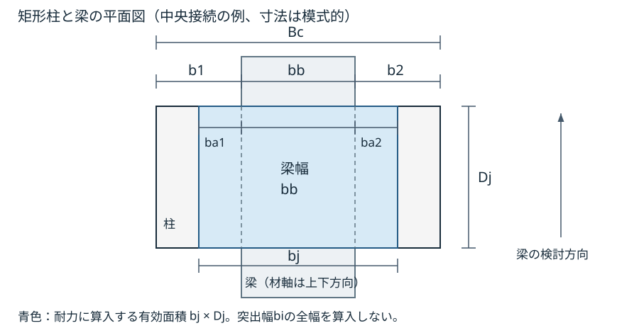
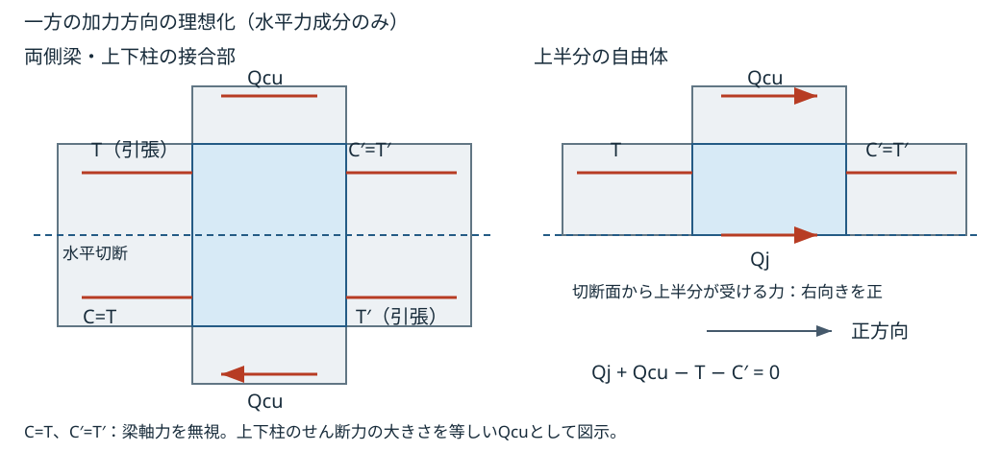

# RC 柱梁接合部 終局耐力

接合部コンクリートの終局せん断耐力Vjuと、梁主筋の引張力から求める設計用せん断力Qduを比較します。仕口パネル解析要素の降伏や、許容応力度による接合部検定とは別の結果です。

## 入力の採用範囲と制限

対象はRC矩形梁が接続し、正のFcを持つRC柱（矩形または円形）が認識された接合部です。
自動評価では、接続柱2本以上・RC梁2本以上を十字、柱1本・RC梁2本以上をT字、柱2本以上・RC梁1本をト字、それ以外をL字に区分します。φは接続梁の総数が4本以上なら1.0、その他を0.85とします。梁の直交方向・定着・拘束条件まで確認して両側直交梁の適合を保証する判定ではありません。

柱のFc・幅・せいは認識されたRC柱のうち最初の1本、bjとT・T′は認識されたRC梁のうち最初の1本から採ります。Djを常に下側柱の寸法と保証する選択ではありません。T・T′はその梁の実配筋上端・下端面積と主筋材料の強度から算定し、協力スラブ筋を自動加算しません。
Qcuは取得できた接続柱の各端せん断力について、局所2方向の絶対値の大きい方を採って平均します。柱端応力が1件も得られない場合のQcu=0は、実際に柱せん断力が0と確認できた結果ではありません。

検討面・上下柱・複数梁の選定、直交梁による拘束、偏心や円形柱の有効幅、欠落応力の扱いを含む全適用条件は未確認です。数値や満足判定が得られても、これらの制限を超えた設計適合を意味しません（[接合部の自動選択と不足条件の調査](https://github.com/hrntsm/SEPIKA/issues/1050)）。

## 耐力と需要の比較

耐力側のVjuと需要側のQduを同じN単位で比較します。Vju>0かつQdu>0の場合、余裕率と検定比は互いに逆数です。

\\[ \text{余裕率}=\frac{V_{ju}}{Q_{du}}\geq1.0 \\]

\\[ \text{検定比}=\frac{Q_{du}}{V_{ju}}\leq1.0 \\]

Qdu=0では余裕率を上限なしとする数値処理です。Vju>0なら検定比は0ですが、Vju=0ではQduの値によらず検定比を上限なしとします。数値や満足判定だけでは、入力や接合部形状の適合を確認したことにはなりません。

## 記号と単位

| 記号 | 意味・採用値 | 単位 |
| --- | --- | --- |
| \\(V_{ju},Q_{du}\\) | 接合部終局せん断耐力・設計用接合部せん断力 | N |
| \\(\kappa\\) | 接合部形状係数。十字1.0、T字・ト字0.7、L字0.4 | 無次元 |
| \\(\varphi\\) | 直交梁による補正。両側直交梁付き1.0、その他0.85という区分 | 無次元 |
| \\(F_c,F_j\\) | コンクリート設計基準強度・接合部せん断終局強度 | N/mm² |
| \\(b_j,D_j\\) | 接合部有効幅・柱の検討方向のせい | mm |
| \\(\alpha\\) | 接合部せん断力の割増率。自動評価は1.0 | 無次元 |
| \\(T,T^{\prime}\\) | 梁の上端・下端主筋の引張力（各面積×主筋降伏強度） | N |
| \\(Q_{cu}\\) | 柱の存在せん断力の平均 | N |

## 材料と有効寸法から求める耐力

### コンクリートの接合部せん断終局強度

コンクリート設計基準強度から、接合部の単位面積当たりの強度を求めます。FcをN/mm²で与え、FjをN/mm²で得る経験式です。

\\[ F_j=0.8F_c^{0.7} \\]

### 接合部有効幅と柱せい

次の図は矩形柱と梁の平面図です。梁幅の両側にある柱の突出幅のうち、耐力に算入する幅をそれぞれba1・ba2とします。Djは梁の検討方向に沿う柱せいで、幅方向のBcとは区別します。

| 記号 | 意味 | 単位 |
| --- | --- | --- |
| \\(B_c,b_b\\) | 柱幅・梁幅（検討方向に直交する幅） | mm |
| \\(b_1,b_2\\) | 梁側面から柱側面までの各側の突出幅 | mm |
| \\(b_{a1},b_{a2}\\) | 各側の突出幅のうち耐力に算入する幅 | mm |

各側で突出幅の半分と柱せいの1/4の小さい方を採り、梁幅に加えます。

\\[ b_{ai}=\max\\{\min(b_i/2,D_j/4),0\\},\qquad i=1,2 \\]

\\[ b_j=b_b+b_{a1}+b_{a2} \\]

現在の自動評価は柱幅Bcと梁幅bbから左右同じ \\(b_1=b_2=(B_c-b_b)/2\\) として算定します。例えばBc=600 mm、bb=300 mm、Dj=600 mmなら、bi=150 mm、bai=75 mm、bj=450 mmです。
図は寸法の定義を示し、梁の偏心や左右の突出幅の違いを個別に評価する式への自動切替はありません。柱・梁の採用方法と円形柱を含む制限は[入力の採用範囲と制限](#入力の採用範囲と制限)を参照してください。

### 接合部終局せん断耐力

有効面積bjDjにFjを乗じ、接合部形状と直交梁による係数を掛けて抵抗値Vju [N]を得ます。

\\[ V_{ju}=\kappa\varphi F_j b_j D_j \\]

κとφの区分は[記号と単位](#記号と単位)のとおりです。自動評価でその区分を採る条件は[入力の採用範囲と制限](#入力の採用範囲と制限)に示します。Fcが0以下ならFj=0、幅・せいの負値は0として扱われるため、不正入力による数値を耐力評価に採用しないでください。

## 作用力の釣合いから求める需要

### 水平切断面の自由体と正方向

図は同一検討面の両側に梁、上下に柱がある接合部について、一方の加力方向を説明する理想化です。梁の軸力を無視し、左梁の上端主筋引張力Tに対する圧縮合力をC=T、右梁の下端主筋引張力T′に対する圧縮合力をC′=T′と置きます。上下柱のせん断力の大きさを等しいQcuとして代表させます。水平力の釣合いに必要な成分だけを示し、鉛直力・柱の軸力と曲げモーメントは省略しています。

上半分の自由体では右向きを正に取り、切断面が受ける接合部せん断力をQj [N]とします。T・T′・Qcuは図示方向の力の大きさです。梁下端の引張力T′そのものは上半分には作用せず、同じ梁の上側の圧縮合力C′を介して釣合いに入ります。

\\[ Q_j+Q_{cu}-T-C^{\prime}=0,\qquad C^{\prime}=T^{\prime} \\]

\\[ Q_j=T+T^{\prime}-Q_{cu} \\]

柱せん断力はTとC′の合力と逆向きに作用するため、接合部せん断力を求める式では差し引きます。この図の力の向きは当該自由体の取り決めであり、解析部材の局所軸の正負とは同一ではありません。

図は反転時や片側梁・柱のない形状の自由体を示すものではありません。各形状への適用や作用方向の整合を、図の追加によって確認済みとは扱いません。現在の自動評価は1本の梁の上端・下端主筋からT・T′を採り、接続柱の局所せん断力の絶対値からQcuを採るため、図の左右梁・上下柱の力を検討方向別に選び出すことは保証されません（[入力の採用範囲と制限](#入力の採用範囲と制限)）。

### 割増と設計用接合部せん断力

釣合いから得るQjをαで割り増し、非負の設計用需要Qdu [N]を求めます。αは力の差全体に掛かり、自動評価では1.0です。

\\[ Q_{du}=\max\\{\alpha Q_j,0\\}=\max\\{\alpha(T+T^{\prime}-Q_{cu}),0\\} \\]

この式は絶対値を取る式ではありません。αQjが負の場合は0となり、反対方向の需要を算定したことにはなりません。欠落した柱端応力からQcu=0とする現在の扱いも、柱せん断力が実際に零という釣合い条件の確認とは区別します。

## 主筋重心と梁の応力中心距離

引張縁から主筋群重心までの距離dt [mm]は、実配筋の段別面積による重心です。1段ではかぶり+せん断補強筋径+主筋径/2、内側の段は主筋径と段間のあき（主筋径の1.5倍と25 mmの大きい方）を加えて配置し、面積で重み付けします。
梁の応力中心間距離は \\(j=7(D-d_t)/8\\) [mm]（Dは梁全せい）です。許容応力度による接合部検定等で使う距離で、Vjuの柱せいDjとは別です。
SRC接合部で用いる主筋間距離 \\({}_mC_d=\text{柱幅}-2d_t\\) [mm]も区別し、SRCの終局検定が提供済みとは扱いません（[SRCの対応範囲](05_SRC_梁_せん断終局.md)）。

## 根拠と確認範囲

靭性保証型指針系の接合部終局強度式を採用しています。日本建築学会『鉄筋コンクリート造建物の靭性保証型耐震設計指針・同解説』（1999年）の原本は未取得・未照合です。φ・bjを含む全適用条件の原典照合完了や、接合部自動評価の実験的妥当性確認を意味しません。

**実装参照**：耐力式は `sepika_design_jp::ultimate::joint`（`crates/sepika-design-jp/src/ultimate/joint.rs`）、入力選択は `sepika_design_jp::joint_wiring::rc_joint`（`crates/sepika-design-jp/src/joint_wiring/rc_joint.rs`）。

