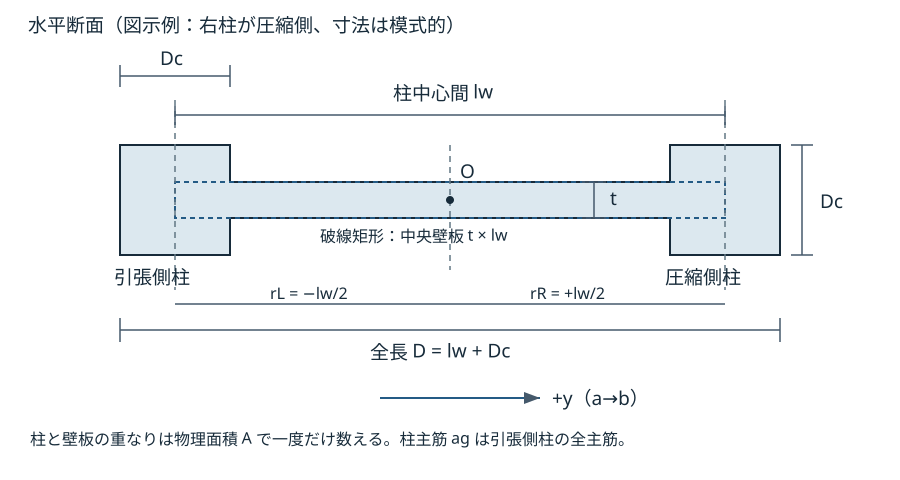
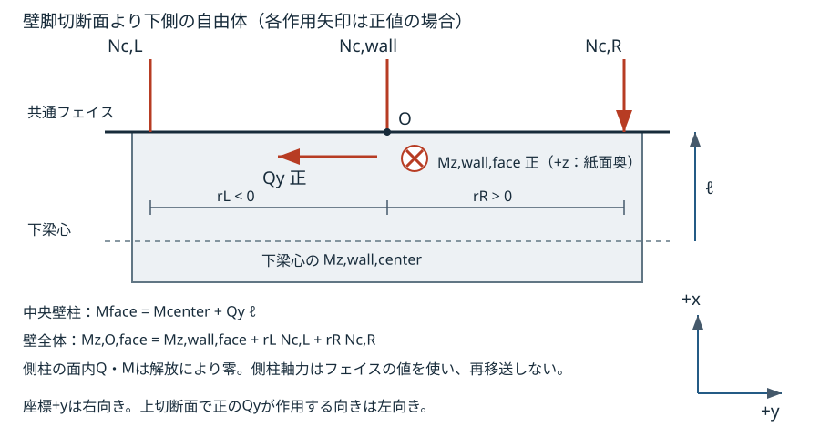

# RC壁の耐力算定用断面と壁脚内力

側柱を含む壁全体の耐力算定用断面を定義し、同じ壁脚フェイスで内力を合成します。

対象は、両側に対称同質の正方形RC側柱を持つ、単独・無開口・矩形鉛直RC耐震壁です。[壁と側柱の適用範囲・未算定条件](08_RC壁の壁脚内力と初期耐力.md#適用範囲と未算定)を確認してください。

## 側柱込みの断面幾何と等価寸法

壁の下辺aからbへ沿壁方向を取り、両側柱の中心間距離を \\( l_w \\) とします。本節の対称な正方形側柱では、両柱の壁方向せい・壁面法線方向幅はともに \\( D_c \\) です。図は右柱が圧縮側となる方向を例示します。逆方向では引張側・圧縮側を交換します。

| 記号 | 意味 | 単位・条件 |
| --- | --- | --- |
| \\( l_w, t \\) | 側柱中心間距離、実壁厚 | mm、有限正値 |
| \\( D_c, D \\) | 圧縮側柱の壁方向せい、付帯柱を含む全長 | mm、有限正値 |
| \\( A \\) | 壁板と側柱の重複を一度だけ数える物理断面積 | mm²、正 |
| \\( t_e, d, j \\) | 等価壁厚、有効せい、応力中心距離 | mm、正 |
| \\( r_L, r_R \\) | 物理断面の図心Oから左右柱中心への沿壁方向の腕長 | mm、a→bを正 |

全長と腕長を先に求めます。

\\[ D = l_w + D_c, \qquad r_L = -\frac{l_w}{2}, \qquad r_R = +\frac{l_w}{2} \\]

物理面積 \\( A \\) は、実壁板と両柱の断面の和集合面積です。図のように柱幅が壁厚以上で、両柱の壁方向範囲が重ならない場合（\\( D_c \geq t,\ l_w \geq D_c \\)）は、中央壁板と各柱の半幅分の重複を控除して次となります。

\\[ A = t l_w + 2D_c^2 - tD_c \\]

この寸法条件によらず、重なる領域は一度だけ数えます。等価壁厚は、この物理面積を全長で除した値に実壁厚の1.5倍の上限を適用します。

\\[ t_e = \min\left(\frac{A}{D},\ 1.5t\right) \\]

上限が働く場合は \\( t_eD < A \\) です。軸応力度の分母に用いる物理面積 \\( A \\) を、上限適用後の \\( t_eD \\) へ置換しません。

有効せいと応力中心距離は次で求めます。\\( d \\) は全長 \\( D \\) と異なり、[せん断スパン比](08_03_RC壁の終局せん断耐力_荒川min_mean.md#平均圧縮応力度とせん断スパン比)の分母には \\( D \\) を使います。

\\[ d = D - \frac{D_c}{2}, \qquad j = \frac{7}{8}d \\]

例えば \\( l_w=4000 \\) mm、\\( t=180 \\) mm、両柱600×600 mmでは、\\( D=4600 \\) mm、\\( A=1332000 \\) mm²、\\( t_e=270 \\) mm、\\( t_eD=1242000 \\) mm²、\\( d=4300 \\) mmとなります。

## 引張側柱主筋と壁筋の鉄筋比

引張側柱の全主筋面積を \\( a_g \\)（mm²）とし、等価断面の引張鉄筋比を求めます。

\\[ p_{te} = \frac{100a_g}{t_ed} \\]

\\( p_{te} \\) は百分率で、1%を数値1として使います。壁板の全縦筋面積を \\( a_g \\) へ代用しません。

明示した壁横筋比 \\( P_{wh} \\) と壁縦筋比 \\( P_{wv} \\) は、いずれも実壁厚基準の小数（無次元）です。横筋比だけを等価壁厚基準へ換算し、耐力式に用いる横筋比を次で制限します。

\\[ p_{wh,e} = \min\left(P_{wh}\frac{t}{t_e},\ 0.012,\ 2P_{wv}\right) \\]

横筋寄与は等価壁厚基準で1.2%以下、かつ壁板の実壁厚基準の縦筋比の2倍以下です。上限側の \\( P_{wv} \\) に \\( t/t_e \\) を重ねません。直交最小筋比から方向別の比を推定しません。

側柱主筋の有無にかかわらず、壁板の縦筋比が未知・非有限・負の場合は初期耐力を算定できません。参考骨格では縦横とも直交最小筋比以上の明示入力が必要です。構造実験による終局強度確認を入力する機能はなく、実験確認による上限の例外は適用しません。

## 同じ壁脚フェイスでの壁全体内力

壁柱の局所xを下から上、yを下辺aからb、zをx×yとします。中央壁柱の軸・曲げは壁厚t×壁長lwの断面で、独立側柱の軸・曲げを含みません。面内せん断剛性は側柱を含む和集合断面に由来します。したがって中央壁柱と側柱の全成分を一律に足し合わせません。

図は壁脚切断面より下側の自由体を示します。上切断面に作用する圧縮正の \\( N_c \\) は−x向き、正の \\( M_z \\) は+z向きです。この切断側では、回収値 \\( Q_y \\) が正のときの作用矢印は−y向きとなります。座標の+y矢印と区別してください。これにより、下から上へ \\( dM_z/dx=+Q_y \\) となり、柱軸力の腕長項は \\( +r_iN_{c,i} \\) となります。

同じ高さ・同じ切断側へ局所軸と端順を正規化します。引張正の回収軸力を \\( N_t \\)、圧縮正を \\( N_c=-N_t \\) とします。中央壁柱は梁心の応答から実フェイスへ移し、側柱は同じ実フェイスで得た軸力を使います。

| 記号 | 意味 | 単位・符号 |
| --- | --- | --- |
| \\( N_{c,wall},N_{c,L},N_{c,R} \\) | 同じフェイスの中央壁柱・左柱・右柱の軸力 | N、圧縮正 |
| \\( Q_y \\) | 中央壁柱の面内せん断力 | N、図の上切断面では−y向きが正 |
| \\( M_{z,wall,center} \\) | 梁心位置の中央壁柱の曲げモーメント | N·mm、+z向きが正 |
| \\( \ell \\) | 下梁心から上方の実フェイスまでの距離 | mm、正 |
| \\( N_{comp},Q_{wall},M_{z,O,face} \\) | 同じ壁脚フェイスにそろえた壁全体の軸力・せん断力・図心Oまわりの曲げモーメント | N、N、N·mm |

中央壁柱の曲げモーメントを、符号付きのまま一度だけ移送します。

\\[ M_{z,wall,face} = M_{z,wall,center} + Q_y\ell \\]

その後、中央壁柱と側柱を合成します。解放側柱の面内せん断力・曲げモーメントは零となる経路であり、側柱から加えるのは軸力とその腕長項です。

\\[
N_{comp}=N_{c,wall}+N_{c,L}+N_{c,R},\qquad Q_{wall}=Q_y
\\]
\\[
M_{z,O,face}=M_{z,wall,face}+r_LN_{c,L}+r_RN_{c,R}
\\]

同じ壁脚フェイスの軸力合成では、圧縮正の各成分を \\(N_i\\)、合成値を \\(N=\sum_iN_i\\) として、\\(|N|\leq32\varepsilon\sum_i|N_i|\\) のときだけ、正負どちらの値も零へ正規化します。\\(\varepsilon=2^{-52}\\) は倍精度の機械イプシロンです。これは相殺に伴う丸め誤差を扱う数値上の判定であり、厳密な全誤差上界を保証するものではありません。絶対的な力・応力のしきい値は設けず、単独の微小軸力は保持します。有意な引張軸力は引き続き適用外とし、耐力式の応力度範囲や物性値は変更しません。

解放側柱の面内Q・Mは零となる経路で、その数値残差を確認します。側柱の軸力腕長Mは零ではありません。軸力の釣合い合成と、壁板・柱の重複を控除した物理面積Aは別の量です。例えばlw=4000、t=180、左右600×600では中央と両柱の解析軸断面積の和は1440000 mm²、物理和集合Aは1332000 mm²です。軸力を重複面積の割合で任意に減算しません。軸剛性モデル自体の妥当性確認を、この内力合成の確認で代用しません。

中央壁柱の下端応答は下梁心位置の値です。下部支持梁の形状・方向・支持関係から実フェイス距離ℓを求め、左右側柱の明示フェイスと実空間高さを照合します。剛性用剛域長をフェイス距離の代わりに使いません。別の接続梁のフェイスが支配する場合、フェイス不明・不一致、対応する位置の応答がない場合は未算定です。

側柱は既に同じフェイスで回収されたNを使い、再輸送しません。絶対値化は輸送と軸力腕長合成の後です。壁脚以外の最大N・最大Mを組み合わせず、総応力へ長期成分を再加算しません。

画面で選択したケース／組合せを検定する場合は、その応答を生成した実荷重集合に対して未対応部材荷重を検査します。対象集合が明示されない検定では、モデル内の全荷重ケースを保守的に検査します。ケース名だけから対象集合を推定しません。

関連項目は[RC壁の終局せん断耐力と初期耐力](08_RC壁の壁脚内力と初期耐力.md)、[RC壁の初期耐力に用いる静的一次参照](08_02_RC壁の初期耐力に用いる静的一次参照.md)、[RC壁の終局せん断耐力（荒川min・mean）](08_03_RC壁の終局せん断耐力_荒川min_mean.md)を参照してください。
