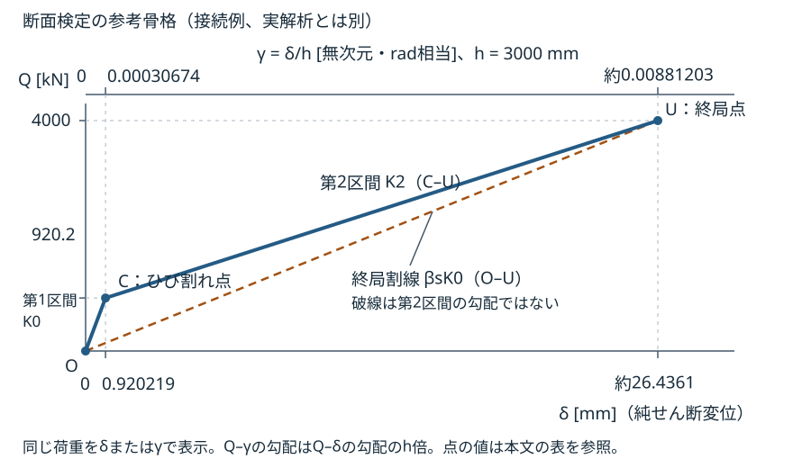

# RC 部材 非線形復元力特性

## 梁の曲げ降伏骨格

本節は、RC矩形梁の材端集中ばねへ採用αyを接続する専用基準の正本です。
一般材端集中ばねとの算定・補正の違いは[専用RC梁基準と一般骨格の対照](04_非線形梁要素のモデル化.md#専用rc梁基準と一般骨格の対照)を参照してください。
以下の無補正の折れ点と総角・追加角の取り決めは、この専用基準に適用します。

### GUIでの指定と制限

#### RC梁基準の指定と適用経路

部材表の「RC梁基準」で「逆対称・同一半部材（軸力なし）」を明示選択します。既定は「未指定」です。部材軸力を設計上見込まない梁に適用します。旧設定の「要再指定」は、軸力の前提を確認したうえで選び直します。
この指定は基準骨格の選択であり、解析で生じる実応力分布へ適合することの確認ではありません。
準備計算では、この基準の指定状態を保持します。
解析の要素モデルと、実行する解析種別で解決した履歴則に応じて、次のように扱います。
RC矩形梁の材端集中ばねでは、履歴則の自動選択は武田型となるため、基準未指定では停止します。

| 対象・要素モデル | 履歴則 | RC梁基準を明示指定 | RC梁基準が未指定 |
| --- | --- | --- | --- |
| RC矩形梁・材端集中ばね | 武田型・逆行型・最大点指向型 | 本節の専用基準。対象条件・骨格成立を診断 | 基準分布が未指定として理由付きで停止 |
| RC矩形梁・材端集中ばね | 標準型・座屈考慮型 | 指定基準と履歴則が適合しないため停止 | 採用αyを用いない各履歴則の既存骨格 |
| RC矩形梁・材端集中ばね | 原点指向型 | 専用基準への接続に未対応として停止 | 専用基準への接続に未対応として停止 |
| RC梁・ファイバーまたはMS | 各モデルの材料履歴則 | 集中ばね専用の指定基準を使用できないため停止 | 各モデルの既存の断面・材料応答 |
| SRC梁・柱の材端集中ばね | 適用外 | [復元力の適用条件を確認できないため停止](04_非線形梁要素のモデル化.md#src材端集中ばねの適用範囲) | 同左 |
| RC柱・CFT柱などその他の専用基準対象外 | 各モデルの履歴則 | 対象外の指定基準として停止 | 適用可能な各モデルの既存骨格。材端集中ばねのトリリニアは一般骨格 |

未指定時に既存骨格を使用する行でも、材料・配筋等の各モデル固有の入力診断は必要です。
専用基準の未指定・不成立を、Mcのクランプ、別の履歴則や要素モデルへの自動変更で救済しません。

#### 専用基準の成立条件

対象は一様な矩形RC梁、上下同一配筋、対象曲げ面の端部解放なし、ハンチなし、同じ両半部材です。
対象軸の弾性梁Iとコンクリート幾何Iが一致する必要があります。
材端集中ばね専用です。基準を指定したままファイバー・MS・柱・その他要素へ変更した場合は、使用できない理由を表示して解析を停止します。
基準未指定のファイバー・MSモデルは、それぞれの既存骨格を使用します。
武田型・逆行型・最大点指向型に限定します。原点指向型は当該初期剛性とひび割れ点を持たないため未対応です。
原点指向型はこの集中RC梁経路では未対応です。コンクリート材料用の履歴則を武田型へ代用しません。
標準型・座屈考慮型は採用αyを用いる骨格の対象外です。基準指定からこれらへ黙って代用しません。
増分・時刻歴はそれぞれ実行する側の履歴則を診断します。
ヒンジ詳細と保有水平耐力解析は材料強度基準、時刻歴は公称値基準で降伏モーメントを算定します。
使用する強度基準でMyが正の有限値でない、Mc<My・Rc<Ryが成立しない場合は、原因付き未算定として解析を停止します。
材料強度基準の解析では、主筋の材種に応じた材料強度係数の範囲も確認します。
当該解析で載荷する長期ケースに中間部材荷重がある場合は、この基準へ接続できません。
長期載荷を無効にした時刻歴では、保存されているだけの未適用荷重を拒否理由にしません。

ヒンジ詳細のM–θ骨格と端ばね応答は弾性角を控除した追加角です。総降伏部材角とは区別して読んでください。
数式との一致は対象構造物への設計適用保証ではありません。一般分布荷重やT形方向別の解析、
新しい履歴則への一般化は本接続の対象外です。

### 採用式と境界

降伏時剛性低下率 \\(\alpha_y\\) は原点から降伏点への割線剛性を初期曲げ剛性で除した値です。普通コンクリートの矩形梁で、部材軸力を見込まない場合の式を採用します。\\(r=a/D\\)、\\(n=E_s/E_c\\) とします。

\\[
\alpha_y =
\begin{cases}
(-0.0836+0.159r)(d/D)^2 & 1.0 \le r < 2.0 \\\\
(0.043+1.64 n p_t+0.043r)(d/D)^2 & 2.0 \le r \le 5.0
\end{cases}
\\]

\\(b,D,d,a\\) は mm、\\(E_s,E_c\\) は N/mm²、\\(p_t=a_t/(bD)\\) は小数です。基本式の引張鉄筋比の範囲は0.4～2.8%です。有効せいは全せい以下、コンクリート強度は18～60 N/mm²とします。材料と寸法が確認できない場合は未算定です。

\\(n=10,p_t=0.01,d/D=0.9\\) では、\\(r=1\\) で0.061074、\\(r=1.5\\) で0.125469、\\(r=2\\) で0.23733、\\(r=5\\) で0.34182です。境界の2.0には基本式を用います。

### せん断スパンと総部材角

一定せん断力・三角形曲げモーメント分布を基準とし、\\(a=|M/Q|>0\\) から

\\[ K_0=3E_cI/a,\qquad R_y=M_y/(\alpha_yK_0) \\]

を求めます。\\(Q=0\\)、反曲点が評価区間外、分布荷重等で三角形曲げ分布を満たさない場合は自動接続できません。
逆対称で両半部材が同じ場合だけ、\\(a=L/2\\)、\\(K_0=S=6E_cI/L\\) とします。
\\(L\\) は節点間長から剛体アーム長を控除した柔部材長です。協力幅算定用のスパンとは区別します。
柔部材長が非正の場合に全長へ置き換えません。

降伏モーメントは日本建築学会『鉄筋コンクリート構造計算規準・同解説』2024年版8条解説 pp.82–83の式(解8.20)で軸力を0とした \\(M_y=a_t\sigma_y j_t\\) を用います。\\(a_t\\) は引張主筋面積 [mm²]、\\(\sigma_y\\) は当該解析の強度基準による主筋降伏強度 [N/mm²]、\\(j_t\\) は引張主筋と圧縮主筋の重心間距離 [mm] です。上下同一の多段配筋では、各段の鉄筋面積と位置から両側の重心を求めます。
降伏モーメントには短スパン式と基本式の双方で引張鉄筋比0.4～2.8%が必要です。主筋は同規準4条p.8に基づき、材種と基準強度が一致するD41以下のSD295系、SD345、SD390、SD490を対象とします。断面に標準呼び名を指定し、公称断面積と配筋の位置から重心を求めます。数値径の配筋は材種の適用を確認できないため未算定です。
上下同一配筋の矩形梁を対象とし、総降伏角は上記の \\(R_y=M_y/(\alpha_yK_0)\\) で求めます。
曲げひび割れは \\(M_c=0.56\sqrt{F_c}Z_e\\)、\\(R_c=M_c/K_0\\) とします。上下同一配筋の矩形断面の図心に対し、鉄筋の位置と面積をヤング係数比で換算して断面係数 \\(Z_e\\) を求めます。コンクリート面積との重複を除くため、鉄筋面積に掛ける係数は \\(n-1\\) です。根拠は技術基準解説書 p.697、式(付1.3-1) とRC規準8条解説 pp.72–73、80 です。

\\(M_c<M_y\\)、\\(R_c<R_y\\) が必要です。

第2勾配は \\((M_y-M_c)/(R_y-R_c)\\) であり、\\(\alpha_yK_0\\) を区間勾配として使いません。
経験式の総降伏部材角に独立したせん断・抜出し変形角を加算しません。

### 弾性梁へ接続する追加端ばね

同じ逆対称基準の弾性角は \\(M/S\\) です。集中端ばねへ渡す追加角と降伏時割線柔性は、

\\[ R_{s}=R-M/S,\qquad f_{s,y}=(1/\alpha_y-1)/S \\]

です。ひび割れ前の追加柔性0を有限の近似ばねへ置換しません。
\\(\alpha_y=1\\) は降伏点まで追加柔性0、\\(\alpha_y>1\\) は負の追加柔性になるため受動ばねへ接続できません。
後者も数式の総降伏角自体は保持します。
追加骨格の第2勾配は \\((M_y-M_c)/(R_{s,y}-R_{s,c})\\) です。総骨格の第2勾配とは区別します。

\\(E_cI=10^{12}\\) N·mm²、\\(L=6000\\) mm、\\(M_y=10^6\\) N·mm、\\(\alpha_y=0.25\\) なら、
\\(S=10^9\\) N·mm/rad、弾性角0.001 rad、総角0.004 rad、追加角0.003 radです。
弾性梁へ総角0.004 radを追加して0.005 radにしません。
この経験式基準の強軸には初期曲げ剛性を用い、独立したせん断柔性を加算しません。
弱軸と軸の既存モデルは別に扱います。

### T形梁の引張方向と幾何断面

下端引張ではスラブを圧縮側として、協力幅 \\(B\\)・全せい \\(D\\) の仮想長方形で
\\(p_t=a_t/(BD)\\) を算定します。下端引張に上端用のI補正を重ねません。
上端引張では元の梁幅 \\(b\\) を使い、協力幅内のスラブ引張筋を加えて
\\(p_t=(a_t+a_{t,slab})/(bD)\\) とし、

\\[ \alpha_y'=\alpha_y I_0/I_T,\qquad I_0=bD^3/12 \\]

と補正します。\\(I_T\\) は参加するコンクリート幅・厚さ・高さから図心を求めた幾何断面二次モーメントです。
鉄筋換算断面や材料ヤング係数比を再度含めた剛性を \\(I_T\\) としません。
総角のT形初期剛性にも同じ \\(I_T\\) を使い、\\(\alpha_y'K_{0T}=\alpha_y3E_cI_0/a\\) となります。
例えば \\(I_0/I_T=0.5\\) なら上端の係数は半分です。

現行の集中ばね解析には方向別のスラブ引張筋面積と正負別骨格の入力が揃っていません。
スラブ協力付きRC梁は理由を表示して解析を停止し、矩形梁として代用しません。
方向別の式を数値評価できることは、T形梁をGUIから解析できることを意味しません。

### 文献と確認範囲

降伏時剛性低下率は『2025年版 建築物の構造関係技術基準解説書』第2版第1刷、pp.697–698、式(付1.3-3)・(付1.3-4) に基づきます。同書では2.0が両式の記載範囲に含まれます。SEPIKAでは同書p.698の梁試験体の検証区分（2.0未満と2.0以上）に従い、境界の2.0には基本式を用います。

ひび割れ点の推定値には実験結果のばらつきがあります。RC規準8条解説p.80では、18～40 N/mm²での推定に加え、40～60 N/mm²ではばらつきを認識したうえで剛性低下率の算定や非線形解析の復元力特性の仮定に使用できるとしています。

T形梁の方向別補正は、日本建築学会『鉄筋コンクリート構造計算規準・同解説』第10版（2024）の8条解説 pp.82–84 を参照します。集中ばねの適用は、上記の指定と検証条件を満たす場合です。

## 耐震壁（せん断非線形トリリニア）

断面検定で算定する参考骨格です。解析で使用する壁エレメントの弾完全塑性せん断モデルとは別です。
ひび割れ点・終局点は純せん断成分に対して評価し、曲げ変形を含む全体剛性を初期剛性に代入しません。

### 参考骨格と実解析の違い

参考骨格を解析骨格として扱わないでください。このQcは断面検定の参考3点と骨格成立判定に使います。

| 比較項目 | 断面検定の参考骨格 | 実解析の壁せん断ばね |
| --- | --- | --- |
| 骨格 | Qc・Qu・K0・βsから作るO–C–Uの3点 | 別途求めたQuで頭打ちになる弾完全塑性骨格 |
| ひび割れ点 | 採用Qcとδc=Qc/K0 | 履歴則のひび割れ点はQu/3（初期勾配上） |
| βsの役割 | 終局点の変形を定める割線剛性比 | 参考骨格のβsを解析ばねへ接続しない |
| 成立・開始の判定 | 本節の参考骨格用入力と適用条件を満たすこと | 解析固有の材料・配筋・開口・軸力・側柱接続等の条件を満たすこと |

参考Qcの未算定は、そのまま解析開始の拒否を意味しません。反対に参考骨格が算定できても、解析を開始できるとは限りません。
解析骨格と履歴則・適用制限は[壁の非線形モデルの面内せん断の非線形性](06_壁の非線形モデル.md#面内せん断の非線形性)を参照してください。

参考骨格の成立には、無開口・同質コンクリート・対応する両側柱と明示配筋などの[入力不足と適用範囲](#入力不足と適用範囲)を満たす必要があります。

### 横筋による剛性低下率

SEPIKAでは、明示した横筋比と降伏強度から次式を用います。

\\[ \beta_s = 0.46 p_{wh} \sigma_{wh}/F_c + 0.14 \\]

ここで \\(p_{wh}\\) は実壁厚に対する壁横筋比（小数）、\\(\sigma_{wh}\\) は横筋の明示降伏強度、\\(F_c\\) はコンクリート設計基準強度（ともに N/mm²）です。
直交2方向の最小筋比 \\(p_s\\) と独立に横筋比を入力します。最小比を横筋比とみなす推定は行いません。
終局耐力式の等価壁厚換算比 \\(p_{wh,e}=p_{wh}t/t_e\\) とも区別し、剛性低下率には換算前の比を用います。
水平力分担の係数 \\(\beta_u\\) とは別の量です。

2025年版技術基準解説書、付録1-3.1(3)⑤b)、p.714、式(付1.3-29)もこの終局点のせん断割線剛性比を示します。
原研究の強度170〜280 kgf/cm²、高さ/柱心距離0.33〜1.63、壁筋比0〜1.5%を適用域とし、
計算では同じ応力単位にそろえた横筋強度/Fcの比を用います。

この比は、終局点を結ぶ原点からの割線剛性を初期せん断剛性で除した値として用います。根拠の位置は2025年版技術基準解説書 p.714、式(付1.3-29)、および2024年版RC規準 p.88、式(解8.28)です。両資料が壁筋比と表記する量には、実壁厚に対する横筋比を用います。

### 耐力・骨格点・単位

無開口壁のせん断ひび割れ耐力Qcは、『2025年版 建築物の構造関係技術基準解説書』第2版第1刷、付録1-3.1(3)④b)、p.712の式(付1.3-27)で求めます。原典はコンクリートの圧縮強度を用いる式で、SEPIKAでは入力した設計基準強度Fcを用います。式の強度の上限は360 kgf/cm²（35.30394 N/mm²）です。参考骨格全体には、これとは別に[剛性低下率の強度範囲](#横筋による剛性低下率)も適用します。以下の式はSI単位に換算済みです。

\\[ A_{w,Qc}=t l_w \\quad [\mathrm{mm^2}],\qquad
\tau_{cr}=\min\left(\frac{F_c}{20},\ 1.5\left(0.4903325 + \frac{F_c}{100}\right)\right) \\quad [\mathrm{N/mm^2}],\qquad
Q_c=\tau_{cr} A_{w,Qc} \\quad [\mathrm{N}] \\]

厚さ \\(t\\) と側柱中心間距離 \\(l_w\\) はmm、コンクリートの設計基準強度 \\(F_c\\) はN/mm²です。Qc用面積には側柱面積を加えません。この式は柱主筋量・軸力を変数に持ちませんが、軸力がゼロであるという意味ではありません。別式(付1.3-26)は、鉛直荷重による壁板の圧縮応力度と、壁板の柱内法長さ・側柱寸法に基づく形状係数を用います。参考骨格ではこの別式を使わず、Quに使う壁全断面の平均圧縮応力度をQcに代入しません。

式(付1.3-27)は実験値の下限に近い傾向を示しますが、個々の壁に対する下限を保証しません（同書p.713）。『鉄筋コンクリート構造計算規準・同解説』第10版（2024年）19条解説pp.308–309の許容せん断力Q1は、同様にひび割れ防止を意図しますが、壁の全せいを用いる別の値です。ひび割れ後の抵抗に対応する許容せん断力Q2とも区別します。参考骨格のQcは許容せん断力の判定値ではありません。

終局せん断耐力Quは建物共通の荒川min／荒川mean二択で、新規モデルの既定はmeanです。
参考骨格の終局せん断耐力も両側柱付き壁を対象とし、圧縮側柱のせいは有限の正値を必要とします。無側柱・片側柱の壁を壁板全縦筋によって代用評価しません。
二式・D/d・等価壁厚teと物理面積A・λの1〜3制限は[壁脚内力と初期耐力](../calc_basis/08_部材終局耐力/08_03_RC壁の終局せん断耐力_荒川min_mean.md#終局せん断耐力の方式と入力)を正とします。
σ0が0〜0.4Fcの範囲外の場合は未算定とし、限界値へ丸めて成功にしません。
\\(Q_c\ge Q_u\\) となる入力は骨格を算定できないと通知し、ひび割れ点を終局点へ丸めません。

剛性用の物理断面積 \\(A\\) は壁板と側柱の重複を控除した軸断面積です。Qc用面積とは別です。
純せん断の有効面積を \\(A_s=A/\kappa\\)、壁高さを \\(h\\) とすると、

\\[ K_0 = GA_s/h \quad [\mathrm{N/mm}],\qquad
\delta_c=Q_c/K_0,\qquad \delta_u=Q_u/(\beta_s K_0) \quad [\mathrm{mm}] \\]

骨格は原点・ひび割れ点・終局点の3点です。せん断角 \\(\gamma=\delta/h\\) は無次元（rad相当）です。RC規準8条解説p.88の層間水平変位の区分でいえば、ここではせん断変形だけを扱い、曲げ変形や基礎回転を含む層間変形角とは区別します。
Q–γ表示では初期剛性を \\(K_e=GA_s=hK_0\\) [N] とし、\\(\gamma_c=Q_c/K_e\\)、\\(\gamma_u=Q_u/(\beta_s K_e)\\) とします。
矩形均質断面の形状係数は1.2、側柱付き断面では実断面のせん断有効面積を使います。軸断面積を形状係数なしでそのまま代入しません。

### 入力から骨格を読む数値例

耐力式自体の検証とは別に、算定済みの耐力・剛性を3点へ接続する例を示します。
QuとK0は下表の値を与えるものとし、この表だけで側柱付き壁のQuや断面剛性を再計算する例ではありません。

| 入力・接続する量 | 値 | 単位・意味 |
| --- | --- | --- |
| \\(t,\ l_w,\ F_c\\) | 200、4200、24 | 順にmm、mm、N/mm²。Qc用面積は840000 mm² |
| \\(p_{wh},\ \sigma_{wh}\\) | 0.002、295 | 順に小数（0.2%）、N/mm²。βsの算定用 |
| \\(Q_c\\) | 920218.95 | N。上記面積とFcによる採用式の値 |
| \\(Q_u\\) | 4000000 | N。算定済み終局せん断耐力として与える値 |
| \\(\beta_s\\) | 約0.151308 | 無次元。終局割線剛性比 |
| \\(K_0\\) | 1000000 | N/mm。純せん断初期剛性として与える値 |
| \\(h\\) | 3000 | mm。上下梁中心間の壁高さ |

この例のQ–δ、Q–γは次の同じ3点を結びます。荷重の計算値はN、グラフはkNであり、
1000 N = 1 kNです。横軸だけを \\(\delta\\) [mm] から \\(\gamma=\delta/h\\) へ換算しても、荷重は変わりません。

| 骨格点 | Q [N] | グラフのQ [kN] | δ [mm] | γ [無次元・rad相当] |
| --- | --- | --- | --- | --- |
| O：原点 | 0 | 0 | 0 | 0 |
| C：ひび割れ点 | 920218.95 | 約920.219 | 約0.920219 | 約0.000306740 |
| U：終局点 | 4000000 | 4000 | 約26.4361 | 約0.00881203 |

第2区間の勾配はC–Uの端点から求めます。原点O–Uを結ぶ終局割線とは異なります。

\\[
K_2=\frac{Q_u-Q_c}{\delta_u-\delta_c},\qquad
K_{2,\gamma}=\frac{Q_u-Q_c}{\gamma_u-\gamma_c}=hK_2
\\]

| 勾配を評価する線 | Q–δの勾配 [N/mm] | Q–γの勾配 [N] |
| --- | --- | --- |
| 第1区間 O–C | \\(K_0\\)：1000000 | \\(K_e=hK_0\\)：3000000000 |
| 第2区間 C–U | \\(K_2\\)：約120700.6 | \\(K_{2,\gamma}\\)：約362101880 |
| 終局割線 O–U（区間勾配ではない） | \\(\beta_sK_0\\)：約151308 | \\(\beta_sK_e\\)：453925000 |

グラフの縦軸をkNにすると、勾配の数値も1000で除します。
例えば第2区間は約120.7006 kN/mmであり、終局割線の約151.308 kN/mmを第2区間に使いません。

図は上表の接続例です。実線の参考3点と、破線の終局割線を区別して読んでください。
終局点以降の区間や除荷・再載荷の経路は、この参考3点に定義していません。
断面検定の参考骨格欄にはQc用面積と第2区間剛性、Q–δ・Q–γの3点を表示します。

照合用に桁を残すと、βs=0.151308333333333、δu=26.436085256375 mm、
γu=0.008812028418792、第2区間勾配は120700.626544296 N/mmです。
表・図の「約」は表示の丸めであり、骨格点や成立条件の判定には丸め前の値を用います。

### 入力不足と適用範囲

横筋材料は「せん断補強筋」欄の対応材種と、明示された有限かつ正のfyが必要です。
未割当・fy欠落・0・負・NaN・∞・非対応材種は、横筋を必要とする出力を部材ID・役割・原因付きの未検定とします。
SD295等の材料名からfyを推定せず、295への補完も行いません。明示fy=295/345は正常入力です。

材料不足の影響は、次の出力ごとに判定します。

| 出力 | 壁筋材料の条件 |
| --- | --- |
| βs・側柱付き壁のQu | 壁縦筋の材料強度は不要。縦筋材料不足だけでは拒否しない |
| Qc式自体 | 壁縦横筋の材料強度は不要 |
| 参考骨格全体 | 横筋材料と明示した縦横筋比が必要 |
| 許容応力度の短期検定 | 縦横両材種の許容値が必要。縦筋不足はこの許容検定だけを未検定にする |
| 長期のコンクリート負担Q1だけの検定 | 壁筋材料は不要 |

短期許容検定では、直交最小筋比と縦横両材種の小さい許容応力度の積を採用します。
縦横異材でもこの積は各方向の鉄筋比×許容応力度の最小値以下となり、壁筋耐力項を過大評価しない安全側の下界です。

参考骨格の縦横筋比は有限非負かつ直交最小筋比以上が必要で、横筋比が未知なら未検定とします。
最小比を用いる許容検定や、別途判定するRC壁の非線形解析開始可否とは区別します。
Quの横筋寄与の上限は、等価壁厚換算後の1.2%と、実壁厚基準の壁板縦筋比の2倍の小さい方です。
βsは上限適用前の実壁厚基準の横筋比を用い、構造実験確認による上限の例外は適用しません。
[終局せん断耐力の入力](../calc_basis/08_部材終局耐力/08_03_RC壁の終局せん断耐力_荒川min_mean.md#終局せん断耐力の方式と入力)を参照してください。

**壁・材料の条件**：参考骨格は次のすべてを満たす断面を対象とします。

- 無開口の鉛直壁。傾斜壁の原研究への適用は未確認のため理由付き未算定です。
- 同質の普通コンクリート。主材はコンクリート区分が必須で、Fcがあっても鋼材・鉄筋区分では代用しません。
- 壁厚中央に側柱中心がある断面と、明示した縦横筋比。

静的検定の参考骨格では、壁脚フェイスのQ≠0を要求し、選択した荷重ケース・組合せの軸力とM/(QD)を使います。せん断スパン比の絶対値を1〜3に制限するため、M=0かつQ≠0でも比1で評価します。壁脚に反曲点がある場合の危険断面や端部拘束に応じた設計適用条件は未確定です。[初期Quと参考骨格の境界条件](../calc_basis/08_部材終局耐力/08_03_RC壁の終局せん断耐力_荒川min_mean.md#平均圧縮応力度とせん断スパン比)を参照してください。

**側柱の条件**：正方形RC柱で、柱軸が壁高さ方向、断面二軸が壁面内・壁面法線に平行な配置だけを扱います。
実局所座標系で判定し、相対0°・90°は同じ断面、45°などは理由付き未算定です。
SRC・鋼材・異材料・円形・方向別せいが未解決の側柱では代用しません。

左右の側柱は断面寸法・配筋が同じで、壁とコンクリート種別・Fc・弾性材料特性が同質であることを必須とします。片側だけの側柱や断面・配筋の非対称入力で、強い側の主筋量・大きい側の断面せいを両側へ代用しません。実在する側柱の断面・コンクリート主材を解決できない場合は、その柱を断面から除外せず、側柱IDと不足役割・原因を付けて参考骨格を未算定とします。
側柱主筋量が不足した入力は未検定です。

**原研究の適用範囲**：縦横異配筋は明示横筋比で計算できますが、その全組合せに対する実験的精度を保証しません。
菅野の回帰資料域に合わせ、\\(F_c=170\text{–}280\\) kgf/cm²（約16.67–27.46 N/mm²）、\\(h/l=0.33\text{–}1.63\\)、横筋比0–1.5%の範囲外を参考骨格の未検定とします。
原研究の回帰相関係数は0.62です。

**開口・算定不能条件**：有開口壁のQcに用いる低減率は、採用式からは定まりません。
許容せん断耐力・Qu・剛性用の低減率や面積控除率で代用せず、有開口のQc・参考骨格は理由付き未算定とします。
次の入力も理由付き未算定です。

- Fc・実壁厚・柱心距離の欠落、0・負・NaN・∞、面積の積やQcのoverflow
- βsが0–1の内部にない、Qc≥Qu、非有限値の発生、初期剛性が非正、終局変形がひび割れ変形以下

断面検定の「せん断参考骨格」欄には「未検定」と理由を表示し、参考グラフは表示しません。ゼロ骨格やクランプで有効な結果へ救済しません。

**入力変更後**は旧結果を現行結果として再利用せず、現在の入力で再検定してください。

### 精度と安全性

横筋式への是正によるβsの増減は縦横の配筋比・fyの大小で変わります。βsが増えると同じQu/K0の終局変形は小さくなり、減ると大きくなります。
この是正を一律に安全側と評価しません。原研究と図の定義への一致と、設計対象での実験的妥当性は分けて扱います。
Qcの変更もひび割れ点と第2区間勾配を変えるため、一律に安全側とは認定しません。
Qc式に軸力項がないことは、任意の引張軸力や全壁形式への適用保証ではありません。
Qcが大きいほど同じ初期剛性で参考ひび割れ点の変形は大きくなりますが、同じ中間荷重での参考変形が小さくなる場合があります。ひび割れ点の大小だけで安全側と判断しないでください。
採用式の対象壁に対する終局変形の精度は未確認です。
入力不足を未検定にするのは誤った耐力・剛性で合格扱いされることを防ぐアプリの入力契約です。

断面の明示横筋比は参考骨格とRC壁解析で共有します。参考骨格専用の部材上書きは解析の実配筋へ流用しません。解析では独立した明示縦筋比と方向別材料も必要です。[RC壁解析の入力と不足時の扱い](../calc_basis/05_構造解析/07_プッシュオーバー解析.md)を参照してください。数量積算は[方向別の壁筋概算](../calc_basis/10_数量積算/01_数量積算の算定式.md#方向別の壁筋概算)に従い、明示横筋比・縦筋比で方向別に算定します。
壁筋比が未入力の方向は理由付き未算定とし、算定できた鉄筋重量は不完全小計として表示します。質量は総断面積に標準RC密度を適用し、積算した鉄筋重量を加算しません。

### 出典と適用範囲

ひび割れ耐力と終局時せん断剛性低下率の根拠は、『2025年版 建築物の構造関係技術基準解説書』第2版第1刷、付録1-3.1(3)④b)・⑤b)（pp.712–714）と日本建築学会『鉄筋コンクリート構造計算規準・同解説』第10版（2024）8条解説（pp.87–88）です。参考骨格は無開口壁の純せん断を対象とします。対象壁に対する変形評価の実験的な妥当性は未確認です。

**実装参照**：`sepika_core::rc_beam_backbone`（`crates/sepika-core/src/rc_beam_backbone.rs`）、`sepika_element::factory::springs`（`crates/sepika-element/src/factory/springs.rs`）、`sepika_design_jp::rc::wall_nonlinear`（`crates/sepika-design-jp/src/rc/wall_nonlinear.rs`）。

