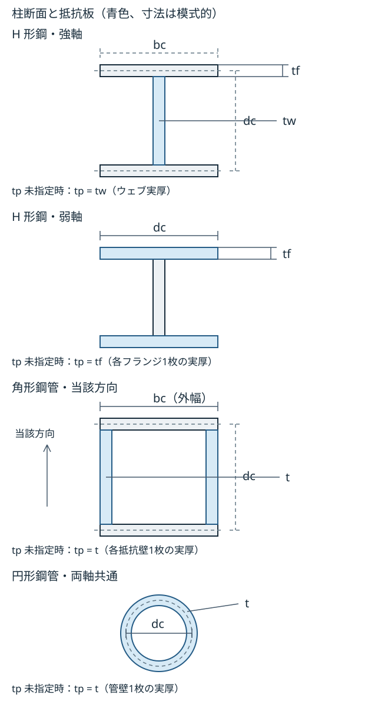

# 仕口パネルの復元力

対象と弾性剛性・幾何条件は[仕口パネル要素](../calc_basis/04_要素剛性/06_パネルゾーン.md)を参照してください。

**仕口パネル要素（S造）の弾塑性**

この節の降伏耐力式と形状係数は、仕口パネル要素をモデル化する S 造に適用します。CFT の式は柱梁接合部の断面算定専用であり、仕口パネル要素の弾塑性モデル化には用いません。

保有水平耐力計算（増分解析）・非線形時刻歴応答解析では、仕口パネル要素の降伏を考慮します。骨格は次の降伏耐力を持つ**バイリニア**（二次勾配比 **0.01**）とし、履歴則は**線形移動硬化**（kinematic hardening。除荷剛性は初期剛性、再載荷で降伏点が移動）です。

軸力比 \\( n=0 \\) の基準降伏耐力を \\( {}\_p M\_{y0} \\) として、次式で定義します。

\\[ {}\_p M\_{y0} = (V\_e/\kappa) (F\_y/\sqrt{3}) \\]

## 形状係数と断面寸法

形状係数 \\( \kappa \\) は、柱2主軸の各方向のせん断抵抗板に対応する寸法で求めます。対象は上記の S 造であり、梁配置には[標準形式の適用範囲](../calc_basis/04_要素剛性/06_パネルゾーン.md#標準形式の適用範囲)を満たす必要があります。寸法が求まることだけで接合形式の適用根拠を確認したことにはなりません。

図は柱材軸に直交する断面で、青色は各方向のせん断抵抗板です。角形鋼管の角部は模式化しており、接合面距離の算定に使う実外周図ではありません。

| 記号 | 意味・図との対応 | 単位 |
| --- | --- | --- |
| \\( d_c \\) | H 強軸はフランジ板厚中心間、H 弱軸はフランジ全幅。角形は当該方向の対向壁の板厚中心間、円形は外径から実壁厚を引いた距離 | mm |
| \\( t_p \\) | 抵抗板1枚あたりの有効厚。未指定時は H 強軸が図のウェブ厚 \\( t_w \\)、H 弱軸が実フランジ厚 \\( t_f \\)、鋼管が実壁厚 \\( t \\) | mm |
| \\( b_c \\) | H 強軸はフランジ全幅。角形は \\( d_c \\) に直交する方向の柱外幅（板厚中心間ではない） | mm |
| \\( t_f \\) | H 強軸式に用いる実フランジ厚 | mm |
| \\( \kappa \\) | 各方向の形状係数 | 無次元 |

「パネル板厚 tp」を指定した場合、\\( t_p \\) は図の実板厚と異なる場合があります。指定厚は抵抗板1枚ごとに用い、\\( d_c \\)・\\( b_c \\)・\\( t_f \\) の幾何寸法を変更しません。入力方法と方向別の実効体積は[仕口パネル要素の寸法と実効体積](../calc_basis/04_要素剛性/06_パネルゾーン.md#仕口パネル要素の寸法と実効体積)を参照してください。寸法・係数は正の有限値を必要とし、フランジ位置を比較する数値公差とは別の入力条件です。

| 柱断面・方向 | 式の参照 | 適用条件・抵抗板 |
| --- | --- | --- |
| H 形鋼・強軸 | [H 形鋼・強軸の式](#h強軸の形状係数) | ウェブ1枚。組立 H 柱は対象外 |
| H 形鋼・弱軸 | [H 形鋼・弱軸の式](#h弱軸の形状係数) | フランジ2枚の純せん断モデル |
| 角形鋼管 | [角形鋼管の式](#角形鋼管の形状係数) | 方向ごとに \\( d_c \\) と直交する外幅 \\( b_c \\) を対応させる |
| 円形鋼管 | [円形鋼管の式](#円形鋼管の形状係数) | 両軸で同じ諸元 |

### H 形鋼・強軸

\\[
\begin{aligned}
\kappa={}&\frac{1}{\frac{2}{3}+\frac{4b_ct_f}{d_ct_p}} \\\\
&+\frac{1}{1+\frac{d_ct_p}{6b_ct_f}}
\end{aligned}
\\]

### H 形鋼・弱軸

\\[ \kappa=\frac{3}{2} \\]

フランジを矩形せん断板として扱う係数です。[弾性剛性の説明](../calc_basis/04_要素剛性/06_パネルゾーン.md#h-形柱の弱軸側の近似)に示す純せん断2枚板モデルに対応し、弱軸接合部の曲げによる低下を含めた容量式ではありません。

### 角形鋼管

\\[
\begin{aligned}
\kappa={}&\frac{1}{\frac{2}{3}+\frac{2b_c}{d_c}} \\\\
&+\frac{1}{1+\frac{d_c}{3b_c}}
\end{aligned}
\\]

弱軸方向では図のせい方向と幅方向を交換し、\\( d_c \\) は幅方向の板厚中心間、\\( b_c \\) はそれに直交する外寸せいとします。

### 円形鋼管

\\[ \kappa=\frac{4}{\pi} \\]

## 軸力による降伏耐力の低減

軸力比は、[仕口パネル要素の採用柱規則](../calc_basis/04_要素剛性/06_パネルゾーン.md)で採用した柱の**現在の試行変位による弾性推定軸力**から、各方向 \\( i=s,w \\) について圧縮軸力 \\( /(F_i A) \\) として更新します。柱軸力と断面積は両方向で同じ値を用い、フランジへの新たな軸力分配は行いません。各方向のせん断抵抗板の F 値を断面全体の軸耐力へ用いる既存式の妥当性は未確認です。初期軸力や直前の確定軸力を固定して用いる方式ではありません。引張軸力では \\( n_i=0 \\) とし、圧縮では \\( 0\le n_i<1 \\) の範囲を対象とします。各方向の降伏耐力は次式です。

\\[ {}_p M_{y,i}(n_i)={}_p M_{y0,i}\sqrt{1-n_i^2}\qquad(i=s,w) \\]

非線形ばねに設定する降伏耐力はこの式の値と一致させ、基準降伏耐力に対する比率の下限は設けません。算定値は有限で **1×10⁻⁹ N·mm 以上**（境界を含む）である必要があります。この絶対値は採用する履歴ばねが降伏値をそのまま設定できる範囲の下端であり、物理的な残留耐力や安全率ではありません。下端未満の値を下端へ引き上げて計算を継続しません。

軸力比が1以上となる軸耐力到達・超過、ゼロ降伏耐力、上記下端未満、軸力比や降伏耐力を有限値として算定できない状態は未対応です。これらの試行は状態を変更する前に、接合部と理由を示して拒否します。既存の刻み再試行条件に従い、解析を継続できなければ停止します。この判定は試行変位から推定した軸力に対する適用範囲の確認であり、反復途中の試行で拒否されても、確定した実柱の軸耐力到達や軸崩壊を意味しません。ゼロ耐力時の履歴則や軸方向との連成挙動の適用根拠は未確認であり、正の残留耐力・剛接合・解析成功へ置き換えません。

降伏式のN・A・Fと形状別の適用根拠は未確認です。全塑性相関式・接合部の最大耐力とは区別します。[降伏耐力と適用根拠](../calc_basis/06_一次設計/07_鋼構造の柱梁接合部.md#s-造柱梁接合部)を参照してください。

この降伏耐力は処女載荷の降伏点と移動硬化の降伏幅を定める値です。降伏後も二次勾配比0.01で硬化するため、応答モーメントの上限値を意味しません。降伏式との一致や未対応状態での停止は、高軸力域の物理的妥当性や接合部全体の安全側を保証するものではありません。

採用柱の i 端から j 端への初期材軸単位ベクトルを \\( \boldsymbol{a} \\)、節点並進変位を \\( \boldsymbol{u}\_i,\boldsymbol{u}\_j \\) とすると、推定引張軸力は \\( N\_e=(EA/L)\boldsymbol{a}\cdot(\boldsymbol{u}\_j-\boldsymbol{u}\_i) \\) です。回転変位はこの評価に含めません。柱の材料応答から回収した軸力や、部材荷重を含む接合部側の断面力ではありません。

柱の軸剛性と各方向の基準軸耐力は、実際の節点間長さ L [mm]、断面積 A [mm²]、採用したヤング係数 E [N/mm²] と方向別基準強度 F [N/mm²] による EA/L [N/mm] と F・A [N] を用います。これらの入力と算定値は正の有限値である必要があり、算定不能は接合部・採用柱と理由を付けた入力エラーとします。1 mm 未満の長さや 1 N 未満の基準軸耐力も実値で評価し、寸法や耐力を数値下限へ引き上げません。変位から求めた軸力比が非有限となる場合も計算を継続しません。

この推定が実際の柱軸力と一致するには、柱の軸応答が採用した E・A・節点間長による弾性軸剛性に従い、初期ひずみ・塑性軸ひずみ・部材荷重による軸力成分等を別途加える必要がないことが前提です。軸塑性化した柱や軸方向の部材荷重を持つ柱について、推定値と接合部側軸力の一致は保証しません。圧縮軸力を小さく推定するとパネル耐力を大きく評価しうるため、安全側の近似とは扱いません。

**非線形応答の利用上の制限**

二方向のせん断ばねは、それぞれ独立した移動硬化履歴を持ちます。二方向せん断間、パネル軸変形、パネル曲げとの連成降伏面は表現しません。固定した軸力比のもとでの一次元履歴と、変動する軸力を含む接合部全体の妥当性は区別する必要があります。

軸力比が変わる場合も塑性履歴を保持して降伏耐力を更新しますが、軸力変化に対するパネル内力の連成接線と軸方向の仕事は含めません。せん断角に関する接線が得られることだけでは、軸変位を含む全応答の整合を保証できません。固定軸力比でも実験による妥当性確認は未実施です。

仕口パネル要素の基準強度は、採用柱の割当鋼材と、各方向の抵抗板の実板厚から求めます。既知材種では材種表の実板厚区分による F 値を優先し、入力済みの降伏強度で上書きしません。表に対応しない名前の割当鋼材は直接入力材料として、正の有限値の降伏強度を用います。既知材種の適用範囲外、必要な実板厚・材料の欠落や不正は理由付き入力エラーとし、40 mm・235 N/mm²や別の部位の強度で補いません。

**実装参照**：`sepika_element::springs::panel`（`crates/sepika-element/src/springs/panel.rs`）。

